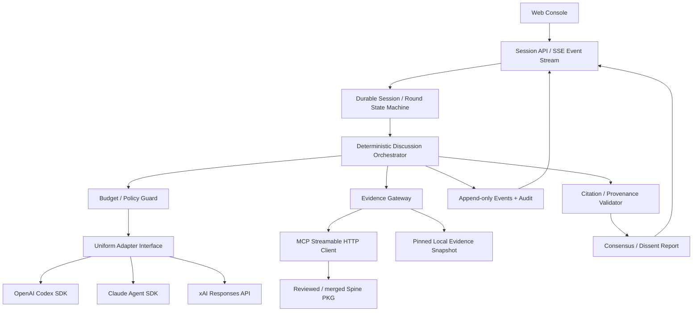

# Active product roadmap — idea discussion workflow (2026-11-01)

The user has refocused delivery on: idea → research/analysis → peer review →
bounded revision → final recommendation. This table supersedes all older active
roadmap/progress tables below. Enterprise P5/R2–R5, PKG P2 and production
benchmark/operations work are deferred, not completed. Existing protections stay.
The original P0–P6 baseline remains 48.33% under its old 30-unit denominator;
W1–W6 uses new explicit product planning weights (not time estimates).

| Phase | Weight | Gate | State |
|---|---:|---|---|
| W1 Idea, providers and saved sessions | 20% | Review existing selection, subscription-only orchestration, history and budgets | Passed |
| W2 Source research | 20% | Bounded opt-in retrieval, shared source snapshot, honest coverage/failure, offline tests | Passed offline |
| W3 Peer review and revision | 20% | Each peer reviewed, revisions attributed, missing coverage explicit, offline tests | Passed offline |
| W4 Final recommendation | 20% | Sources, review coverage, recommendation, dissent and next actions in UI/report | Passed offline |
| W5 Offline acceptance | 10% | Full quality gate and workflow regressions, inference disabled | Passed offline |
| W6 Authorized live acceptance | 10% | One complete usable Codex/Claude discussion with honest warnings and recommendation | Passed: one bounded Codex/Claude subscription discussion, six usable responses, complete peer coverage, nonblocking prose warning; split outcome retained |

Current overall and workflow track: 100% for the scoped W1–W6 gates. W6 passed
on 2026-11-02 after the warning-policy correction; this is one successful bounded
run, not proof of reliability for every idea or a production-readiness claim.
Weights are unchanged; the final 10% moved only after verifying the live artifacts.
Current task: PR #5 review/merge verification, bounded run verification and result
recording — 4/4 complete. Inference disabled, Grok off. Enterprise hardening and PKG
remain deferred and unestimated.

Review: existing three-round orchestration already provides independent views,
frozen peer exchanges, final JSON positions, conservative agreement, explicit
unsupported claims, unknown subscription costs, saved UI sessions and call bounds.
Gaps: no source retrieval, no structured peer/revision coverage, silent peer text
clipping. Three rounds are one bounded revision cycle; no extra synthesis call or
unbounded debate is required. Research must disclose its actual source scope.

Measured pre-change PKG: composePrompt and makeReport each have one bound caller
(Engine.run); Engine.create/run each have two (createApplication and saved-session
fixture); createApplication has two (protected application and API fixture);
parsePosition has three (assessDiscussion, Engine.run, SavedSessions.restore).
Regression gaps reported no uncovered impacted symbols for the four free functions;
Engine.create/run qualified queries returned not found. TypeScript unresolved calls
are not tracked; results are a floor. No result was truncated. Docs found README and
this plan; Engine.create also matched irrelevant ignored runs docs. Confirmed source
and tests directly because lexical coverage is incomplete. New research/workflow
helpers have no pre-change callers. No claim of exhaustive graph coverage.


### Live acceptance of prose warnings (2026-11-02)

PR #5 was already merged at 291a4d22fe5adfeab690ddd8b5a34ac5638bce1f. Review found
no blocking issues; source/tests matched the offline-tested commit (TypeScript,
492 Node and 33 Python tests). One user-authorized PKG-search discussion used
subscription-only Codex gpt-6-astra and Claude claude-opus-5-5, with no API-key fallback.
Three rounds, six application calls, 90-second call deadlines and a five-minute
cancellation watchdog; no retries or additional sessions. No external research or
PKG retrieval was requested: the subject was PKG search design with stated assumptions.

Session 8ba1d31c-c7c2-4584-baf2-8156091d8c3c completed with six original responses,
four full prior-round peer exchanges, unique peer entries, complete declared
review/revision coverage and two usable final positions. Claude's round-two reason
was 524 characters against the 400 threshold; the warning remained visible without
blocking coverage or the report. Final revision reasons were 170/155 characters.
Both provider proposals, next actions and unresolved disagreements are in the report.
Directions differ (Codex revise, Claude pilot), so the assessment is split rather
than invented consensus. The final recommendation is the explicit procedural
fallback to compare proposals and define success criteria; it is not a synthesized
joint technical endorsement.

Usage: 158,684 input and 6,007 output tokens. Claude's reported estimate is $0.145037,
not a subscription invoice; all three Codex costs remain unknown. Final cleanup
confirmed both inference flags disabled, Grok excluded and no listening server.
Original texts were checked against the report. Evidence: ignored
runs/length-warning-live/{verification,report-checks,acceptance-summary,inference-state}.json
and runs/8ba1d31c-c7c2-4584-baf2-8156091d8c3c/report.md. These checks verify this
single discussion; broader live research, new-account login UX and production
reliability are outside this acceptance. No further live run is authorized.

### Prose length warnings (2026-11-02)

User-authorized policy change: a prose field exceeding its existing character
threshold is now a warning, not grounds to discard an otherwise usable response.
Version-2 validation distinguishes valid, warning and invalid; each issue includes
severity, with actual/limit/excess unchanged. Original response text is never trimmed,
rewritten, deduplicated or retried. Review/revision reasons, revisedView,
recommendation, rationale, question/risk/disagreement/action text and claim prose
use warnings. Numeric thresholds remain drafting targets and diagnostic thresholds.
Malformed JSON, missing/unknown fields, invalid types/choices, empty text, duplicate
peers/claims, identifier/reference limits, array counts and whole-response bounds
(5,000 review / 12,000 final UTF-16 units) remain blocking. Warnings do not establish
factual truth, agreement or peer coverage; those checks still run independently.

Canonical parsers now retain warning-only content, so coverage and final reports
can use it. UI cards and report diagnostics show length warnings without labeling
those responses excluded. Historical saved assessment/events/reports are unchanged;
current diagnostics are labeled as current policy. Offline replays are separate
artifacts, not silent edits to history or new provider results.

PKG measurements before edits: ResponseValidator has 26 bound call sites across
parseClaims, parsePosition, parsePeerResponses and parseReview; 16 touched nodes.
Its valid/issue/text members have 0/16/7 bound callers. responseValidation has six
call sites; workflowMarkdown and responseMarkdown each one makeReport caller;
validationNotice has two appendResponse call sites and an implementation-plan doc.
TypeScript/JavaScript unresolved calls are not tracked; none of the results was
truncated. Member regression-gap queries returned not found. Class/function gaps
flagged validClaimAssessment, prepareDemo and preparePersonalDiscussion; their direct
existing tests are in the full gate. UI gaps flagged appendResponse/openSaved/
restoreSavedView; live-event and saved-session VM DOM tests exercise warning cards.
Graph coverage is a floor, not a claim of exhaustive tracing.

Offline replay of both saved live failures (b2ac478b and 4991baa4) delivered their
six exact recorded responses through fake adapters, with zero provider/model calls.
Both now have complete declared peer coverage and two usable final positions. The
428-character revision becomes a warning; the other run's 412-character review and
1,220-character revisedView become warnings. Outcomes remain direction-alignment
and split respectively: no forced consensus. SHA-256 checks confirm both original
events and reports unchanged. Evidence and separate reassessed reports are in ignored
runs/length-warning-replay/. Private saved responses are not committed as fixtures.

Existing synthetic regressions now test the explicit warning policy, preserving
original text, exact limits and UTF-16 counts. Mixed warning/error tests prove a
length warning cannot mask duplicate peers or weaken the total-response cap. Full quality gate passed: TypeScript, 492 Node tests and 33 Python tests. Evidence:
runs/length-warning-replay/check.log. Live
behavior is not verified. Inference disabled, Grok off, no authentication/model calls.
Enterprise hardening and PKG remain deferred. W6 reopened rather than overstating
readiness based on prior unrelated acceptance.

### Concise revision reasons (2026-11-02)

The authorized post-PR-3 discussion returned six responses with unique peer entries
and four complete peer exchanges. Claude's final revision reason was 428 characters,
28 above the unchanged 400 limit; the outcome remained insufficient. Original
responses and diagnostics were preserved. No additional live attempt is authorized.

Revision prompts now request one short sentence targeting at most 180 characters,
explicitly distinguishing that drafting target from the 400 UTF-16-unit validation
maximum. Supporting detail belongs in rationale and remaining dissent in disagreements,
within their existing limits. Instructions require a per-reason check and substantial
rewriting when length is uncertain. They retain unique peer entries and forbid
mid-sentence cuts or missing required fields. The shared peer instruction now asks
for a summary instead of cataloging every point. No parser, limit, response storage,
repair, retry or provider configuration changed. Prompt compliance is not guaranteed.

Measured pre-change PKG for composePrompt: one bound caller Engine.run; two touched
nodes (module and caller); README and this plan referenced. No truncation; TypeScript
unresolved calls are not tracked. Regression gaps flagged prepareDemo and
preparePersonalDiscussion among five impacted symbols; their direct demo/setup tests
remain in the full gate. Investigation also retrieved ignored run scripts, which
were excluded from the change scope. Graph coverage is a floor, not exhaustive.

Four new offline tests cover both providers' revision prompts, preserved peer text,
the synthetic 428-character failure through the engine/report/events with six calls
and an insufficient outcome, and unchanged ASCII/UTF-16 boundaries. The 180-character
target does not tighten validation: 181 through 400 units remain valid.
Verification passed: TypeScript, 491 Node tests and 33 Python tests. Evidence:
ignored runs/revision-length/check.log.
No model/authentication calls; inference disabled and Grok off. Enterprise hardening
and PKG remain deferred. Live behavior of this change remains unverified.

### Unique peer declarations and demo readiness (2026-11-01)

Peer-review and revision prompts now enumerate the exact available peer IDs and
required array length for that round. Each provider gets one object, aggregating
its points within the existing 400-character reason limit; mixed decisions are
unresolved, with remaining dissent in openQuestions/disagreements. A final checklist
requires unique IDs and exact coverage. Original responses, parsers, validation
limits, storage and failure outcomes are unchanged. No deduplication or retry occurs.
Prompt instructions reduce ambiguity; they cannot guarantee model compliance.

Measured pre-change PKG impact for composePrompt: one bound caller Engine.run,
two touched symbols including the module; README and this plan referenced. Results
were not truncated; TypeScript unresolved calls are not tracked. Regression gaps
reported prepareDemo and preparePersonalDiscussion uncovered among five impacted
symbols. Direct demo/subscription-setup tests exercise those helpers and passed in
the full gate; graph coverage is not exhaustive.

Verification: TypeScript, 487 Node tests and 33 Python tests passed. Nine new tests
cover round-two/three contracts with zero/one/two available peers, independent-round
privacy, unchanged duplicate rejection with preserved originals in session/report/
events, six-call bounds, insufficient outcomes, and 400/401-character boundaries.
Evidence: ignored runs/unique-peer-instructions/check.log. No authentication or model
calls; Grok off, inference disabled, enterprise hardening and PKG deferred.

Demo readiness: mock walkthrough and bundled saved sample are ready. Fresh-clone
subscription status previously confirmed both providers. The latest authorized
real discussion d60f2632-5245-485d-84d4-8a8f618b654f returned six responses, but
Claude's duplicate review/revision entries left only one valid final position and
an insufficient outcome. This prompt change is offline verified only. A successful
live rerun remains unverified and requires separate authorization; prior W6 scope
is not evidence that this specific regression is fixed in live model behavior.

### Personal subscription setup (2026-11-01)

Added npm run setup (offline help), explicit login codex/login claude commands,
status with content-free ready/not-confirmed results, and start:real with mandatory
--enable-inference. Browser authentication is delegated to pinned installed CLIs:
Codex forced_login_method=chatgpt; Claude forceLoginMethod=claudeai and --claudeai.
Only fixed auth commands are allowed; no prompt, API key, Console or arbitrary flags.
Provider subprocess environments reuse subscriptionEnvironment's allowlist. Credentials
remain in each user's provider store; Koinous does not copy or save credentials.
Status requires Codex's exact ChatGPT marker or Claude loggedIn=true/authMethod=claude.ai;
unknown methods, API keys, helpers, injected tokens and third-party modes fail closed.
Login success is not quota, entitlement or inference verification.

Real startup overrides inherited live flags to off, checks explicit opt-in and both
subscription statuses, then enables only this server process. Grok always disabled.
No .env read/write. Starting the server sends no model prompt; user UI submission is
required. Shutdown clears the process opt-in. Existing adapter login restrictions,
read-only/tool controls and unknown-cost reporting remain unchanged.

PKG-first investigation found subscriptionEnvironment, CodexAdapter and ClaudeAdapter;
confirmed source directly. No existing functions changed: setup and real-launcher
helpers are new, with no pre-change blast-radius callers. Pinned CLI login --help
and official Codex authentication / Claude CLI reference verified command contracts.
No actual login, auth-status or model command was run during development.

Verification: TypeScript plus 478 Node and 33 Python tests passed. New offline tests
cover fixed commands, wrong/API/unknown auth methods, redacted status, login failure,
explicit opt-in, both-provider gate, Grok exclusion and no sessions on startup. Real
runner is replaced with fakes; npm run setup ran offline, and start:real without flag
refused before auth. Browser login, live status and real inference remain unverified
until separately authorized. Evidence: runs/subscription-setup/check.log.
Enterprise hardening and PKG deferred; W1–W6 prior scoped acceptance unchanged.

### One-command mock demo (2026-11-01)

`npm run demo` starts the existing application in mock mode on localhost with an
explicit MockAdapter-only factory, Codex/Claude defaults, Grok disabled and both
live-inference flags 0. It does not load .env or require dependency installation.
Inherited mode, model and provider settings cannot select real adapters. The new
launcher installs a bundled synthetic six-response saved discussion once, preserves
existing local files, reports corrupt/duplicate history rather than overwriting it,
and prints a direct saved-session URL. No private real discussion is bundled.

PKG-first investigation located createApplication, Engine, MockAdapter and
SavedSessions; source was read to confirm their contracts. Existing functions were
not changed, so no existing-symbol blast-radius claim is made. New prepareDemo has
no pre-change callers. Changes are isolated to launcher, fixture, npm command,
documentation and an offline test. Existing protections are unchanged.

Offline test covers inherited live environment, repeated seed preservation,
malformed local sample, report sections/originals and six new mock responses.
Clean-copy startup used no node_modules, a deliberately live .env, and inherited
live flags: npm run demo still started mock-only. Browser verified the bundled
six-response saved session, complete declared peer/revision coverage, recommendation,
next actions, dissent, only Codex/Claude selectable and mock/no-model banner.
A first full gate and isolated native-CLI check hit the existing startup deadline;
both pinned CLIs later passed isolated version/help (no authentication) with unchanged
binary hashes and no code or sandbox changes. Final unchanged gate passed TypeScript, 474 Node and 33 Python tests.
No new model/authentication calls. Enterprise/PKG deferred; W1–W6 scope unchanged.

### UI download verification and team demo handoff (2026-11-01)

Clicked Download Markdown report in the saved PKG-search discussion UI. Verified
actual browser download: six of six original response blocks match events exactly,
three next actions and all 15 unresolved items match the recorded assessment.
Recommendation, provider rationale, risks and disagreement sections are separated
with Markdown headings/lists. Original saved report/events hashes unchanged; prior
validation failures remain visible. No new authentication or model calls.

Added DEMO.md and safe .env.example; clarified README .env loading and ignored local
env variants. Source package uses an explicit allowlist, excluding runs, credentials,
node_modules, caches and Git history. Scanned for local credential values and private
key material; only a synthetic DLP test marker (no key material) was encountered.
Extracted package started without node_modules or .env on localhost:3061, then
completed three rounds/six deterministic Codex/Claude mock responses. This verifies
the credential-free setup, not fresh real-provider entitlement or model quality.
Source/tests unchanged since the passing 473 Node + 33 Python + TypeScript gate.

GitHub destination authorized: synaptixs/koinous, private by default. Publication
uses a separate clean repository, never the unrelated parent projects history.
Saved user discussions are excluded from source; DEMO.md explains optional reviewed
session transfer and the real run's incomplete structured peer-review coverage.
Evidence and source archive: runs/ui-report-demo-2026-11-01/. Enterprise/PKG deferred,
Grok off and inference disabled. Active W1–W6 prior acceptance unchanged.

### Readable downloaded reports (2026-11-01)

Review/implement/verify/document complete, 4/4 equally weighted. Markdown downloads
now lead with final recommendation, numbered next actions, per-provider rationale,
proposal, risks and actions, explicit disagreements, complete unresolved gaps and
claim checks. Round-two reviews and round-three revisions render structured prose.
Invalid responses retain diagnostics and unchanged originals; originals use fences
longer than any embedded backtick sequence. No validation limits or outcomes changed.

The report endpoint renders terminal sessions from recorded outcomes. Legacy saved
sessions with no outcome remain explicitly unassessed. Existing stored reports and
events are never rewritten. Saved downloads include the original report as an audit
appendix, preserving evidence excerpts not restored into the current session model.
Use ?format=original for the exact stored report. Downloads have attachment headers.
This is deterministic presentation with no provider construction or model calls.

Measured PKG: makeReport has one bound caller Engine.run; outcomeMarkdown one
makeReport caller; createApplication two callers (createProtectedApplication and
API test setup). All three regression-gap queries reported no uncovered impacted
symbols. Results untruncated; TypeScript unresolved calls not tracked. README and
this plan were linked docs. Investigation also returned ignored runs noise, so
production paths were confirmed directly. Results are a floor, not total coverage.

Verification: npm run check passed TypeScript, 473 Node and 33 Python tests. Added
structured transcript/original preservation, malformed/overlength/fence tests and
saved-download integration covering recorded outcomes, unknown costs, deterministic
output, unchanged files, no provider factory calls and legacy unassessed behavior.
A legacy fixture initially failed due to noncontiguous event sequence numbers;
corrected fixture and full gate passed. First restricted-shell gate stalled on
worker fixtures; stopped that run and used approved offline fixture permissions.

Fetched the user's saved PKG-search report from restarted localhost:3053: all six
originals, both prior validation diagnostics, summary sections, unknown costs and
attachment headers verified. Original report/event SHA-256 unchanged; health reports
inference disabled. Mock viewer also restarted on 3030. No live authentication or
model calls; Grok off, enterprise and PKG deferred. Evidence, downloaded report,
impact measurements and quality-gate log: runs/readable-report-2026-11-01/.
W1–W6 prior acceptance unchanged; this is a presentation improvement only.

### Readable discussion UI (2026-11-01)

Task review/implement/verify/document passed (4/4, equal weights). Final assessment
now uses a prominent recommendation, explicit alignment and participation badges,
numbered actions, per-provider reasoning/risk cards and visible disagreements.
Claim checks and complete unresolved-gap lists expand on demand. Canonical caveats
and validation warnings remain visible; presentation does not infer new consensus.
Initial analyses render a safe Markdown subset (headings, lists, emphasis, code,
quotes and tables) using DOM text nodes, never raw HTML. Exact original responses
remain expandable. Existing structured review/revision cards are preserved.

Measured pre-change PKG impact: append has six bound calls across appendResponse,
showWorkflow and openSaved; appendResponse, showOutcome and showWorkflow each have
one bound openSaved call. Results untruncated; JavaScript unresolved calls are not
tracked. Regression gaps include openSaved/restoreSavedView and append's response/
workflow callers. Offline UI tests cover live events and saved-session rendering;
these graph results are a floor, not exhaustive coverage. Evidence: impact.json.

Verification: npm run check passed, TypeScript plus 470 Node and 33 Python tests.
New tests exercise Markdown structure, literal unsafe markup, exact originals,
recommendation sections, dissent/unsupported claims and repeated rendering.
Visually inspected the saved real PKG-search discussion on port 3053. Saved events
and report hashes unchanged; no model/auth calls. Both inference flags remain 0,
Grok disabled, enterprise/PKG deferred. Main mock app restarted on 3030. Evidence
is in runs/readable-discussion-ui-2026-11-01/ including verification.json,
check.log, original-hashes.json and formatted-actions.png. Prior W1–W6 scope unchanged.

### User idea: PKG search over MCP — bounded subscription discussion (2026-11-01)

One UI-submitted discussion of the user's own idea, Codex gpt-6-astra and Claude
claude-opus-5-5 through subscription login, no API-key fallback. Session
f52714bf-4247-4877-8a0c-2eaa41ec9355. Six application calls, three rounds, 90-second
call deadlines, five-minute discussion watchdog, one-session admission, no reruns.
Grok disabled, no VM. UI at http://127.0.0.1:3053. Port 3052 was already occupied
by an unidentified listener and was left untouched. Main mock app also untouched.

All six nonempty replies returned; all four full prior-peer exchanges verified.
Both final positions passed validation, and final recommendation/review/revision
cards were inspected in the UI. Full acceptance FAILED: Claude R2 reviews[0].reason
was 424 characters (400 limit, 24 over); Codex R2 revisedView was 1227 (1200 limit,
27 over). Original responses and limits preserved, no repair/retry. Both reviews
remain visible but excluded from structured coverage; final assessment honestly
reports direction-alignment, not unanimous endorsement, and incomplete peer coverage.

Both proposed a symbol-aware lexical plus typed-graph baseline, with semantic and
hybrid RRF evaluated under matched budgets before rollout. They recommended bounded
search/fetch/expand tools, revision-consistent provenance, authorization, explicit
conflicts, citations and graph-coverage limits from the outset; reranking only after
measured benefit. Disputes remained over exact-hit priority and whether code at a
revision is a default authority for static behavior. No corpus benchmark was run.

Primary background was manually checked and supplied equally as optional context:
Elastic hybrid search docs (https://www.elastic.co/docs/solutions/search/hybrid-search)
and MCP tools spec (https://modelcontextprotocol.io/specification/2025-06-18/server/tools).
This was not an indexed evidence snapshot or the app's automated research stage.
The app correctly marks Claude's two factual background claims unsupported under
its evidence-ID contract; the external source checks do not rewrite that assessment.
No product PKG grounding implementation resumed; enterprise/PKG remain deferred.

Reported input 173917, output 8530 (182447 total; cache/reasoning breakdowns not
added twice). Claude estimate $0.1885846, not subscription billing; three Codex costs
unknown. No claim of a total charge or enforced token ceiling. Application inference
was disabled immediately after single-session admission, preventing another start;
existing admitted work finished. Process state verifies enabled=false,
grokEnabled=false; .env remains off for both and disables Grok from new discussions.

Evidence: runs/pkg-idea-subscription-2026-11-01/verification.json, prompts.jsonl,
inference-state.json and sessions/f52714bf-4247-4877-8a0c-2eaa41ec9355/{events.jsonl,report.md}.
The acceptance verifier exited nonzero on the invalid review fields; subsequent
checks explicitly recorded acceptancePassed=false while confirming six replies,
four exchanges, two valid final positions and disabled inference. No application
source/tests changed; no additional quality-gate rerun. Prior W1–W6 scope unchanged.

### Mock app startup and saved Grok reopening verified (2026-11-01)

Task review/start/verify/document complete (4/4, equal weights). No listener was
present on port 3030, so a fresh application was started via npm start, explicitly
MODE=mock, KOINOUS_PROVIDERS=codex,claude, KOINOUS_DISABLED_PROVIDERS=grok and both
inference switches 0. The app is left running on http://127.0.0.1:3030.

Browser verification: banner says Mock mode / no model calls; new-discussion
selection contains only OpenAI Codex and Anthropic Claude, checked, with six-call
maximum. Grok remains available in the history filter, independently of new-session
availability. Native saved-session search and Open saved discussion reopened
session a2417410-0791-4f18-a4cd-25c069527f8b read-only. All nine historical responses
are visible, including three Grok responses across rounds 1–3; original provider
and model metadata and the report link remain present. This older session has no
recorded agreement assessment and its legacy prose shows current structured-format
validation warnings; these are preserved, not repaired or represented as new failures.

Read-only local API checks confirmed the same roster, completed/read-only session,
nine entries, three Grok entries, nine historical calls and byte-identical original
report. Saved artifact hashes were unchanged across these reads. Evidence:
runs/mock-provider-ui-2026-11-01/verification.json. No discussion was started, no
provider/authentication/VM/model test ran, and no product code changed. Full quality
gate not repeated; prior 468 Node + 33 Python + TypeScript pass remains applicable.
PKG map consulted; known saved-session loader used for read-only confirmation.
Enterprise hardening and product PKG remain deferred. Overall scoped W1–W6 unchanged.

### Bounded Grok diagnostics and configurable disablement (2026-11-01)

User scope: offline implementation only; subscription login, no API-key fallback,
inference off, enterprise hardening and PKG deferred. W1–W6 retains its prior scoped
100%; Grok acceptance is unpassed. No new auth/model/VM tests authorized or run.

Local .env now sets KOINOUS_PROVIDERS=codex,claude and
KOINOUS_DISABLED_PROVIDERS=grok; both inference opt-ins remain 0. New app sessions
reject disabled providers before adapter creation, and both health catalogs omit
them. The availability restriction is separate from selection schema validation,
so completed Grok discussions can still reopen. The minimum two-provider contract
and supported identifiers remain unchanged. Startup scripts load .env if present;
existing shell values take precedence, and existing processes need restart.

New optional grokDiagnostics metadata records immutable fixed-schema counters.
Protocol progress counts matching-session message chunks, thought chunks and
x.ai/session_notification envelopes, never content or arbitrary event labels.
An extension notification count is not a retry count; its payload is ignored.
Proxy counters distinguish accepted sockets, attempt/concurrency limit rejection,
header/destination-policy rejection, DNS/public-address validation, dial failure,
lifetime expiry, byte-limit rejection, tunnel I/O failure and established tunnels.
Counters saturate at 2147483647; no destinations, credentials, IDs, raw errors,
response/thought content or TLS data are retained. Categories are not a complete
partition: cleanup can interrupt observations. Null proxy metadata means unavailable.

The trusted guest wrapper samples at most 120 times at one-second intervals and
emits one final snapshot. Frames stay below 1024 bytes; nonblocking writes drop on
backpressure/disconnect instead of blocking cleanup. CLI stderr remains DEVNULL.
Host parsing is restricted to the isolated-runtime path, exact keys and integer
bounds, nondecreasing values, at most 122 accepted frames, and 1024-byte lines.
Oversized lines cannot inject valid-looking suffixes. Transport and policy limits
are unchanged. No added network hosts, retries, tool permissions or timeout extension.
Snapshots attach synchronously at cancellation/timeout and persist through the
engine's existing saved-event path. Evidence is the last observed sample at response
or abort, not necessarily final teardown totals; late shutdown frames may be absent.
Subscription costs remain explicit unknowns. No historical timeout diagnosis is
claimed, and saved original smoke artifacts are not modified.

Verification includes offline rejection counters and policy controls, parser abuse,
redaction, immutable frames, session mismatch, timeout/save/reload, diagnostic
backpressure, 120-sample cap, provider disablement before dispatch, and reopening
saved Grok sessions. Final quality gate passed: TypeScript + 468 Node tests + 33 Python tests.
Saved smoke hashes unchanged; configured roster/disablement and both inference
flags verified directly without launching adapters.
Evidence: runs/grok-diagnostics-offline-2026-11-01/check.log, history-check.log,
impact.json, config-impact.json and verification.json.

PKG investigate consulted first; direct source confirmation followed its lexical
results (ignored bundled run material polluted results). Measured buildProtocol:
two bound launchBuild call sites; README doc; uncovered launchBuild/run reported.
Reply had no bound callers or gaps. Broker pump had one handle caller; other
queried Broker methods had zero bound callers, not proof of no consumers;
__init__ had two untraced same-name sites and accept three (including unrelated
matches). Python qualified-method regression queries returned not found.
Guest relay has one run caller, with run/main reported uncovered. Broad run query
was truncated (15 matches), included guest.run with one main caller and nine
untraced same-name sites, and regression results selected unrelated bundled code;
this query does not establish guest test coverage. Direct guest/egress fixtures
were therefore inspected and exercised. Destination had one handle caller and one
untraced test call; it was inspected, not modified.
ConfiguredProviders has two bound app callers; createApplication two; protected
application three test-fixture callers, with no gaps returned for these three.
ValidateProviders has four bound callers (adapters, engine, configuration, selection)
and createAdapters reported uncovered; validateProviders remains unchanged to keep
saved-history validation independent of enabled providers. TypeScript unresolved
calls are not tracked; caller lists are floors, not exhaustive blast-radius claims.
The untracked POC branch/work was preserved; no commit/push requested.

### Offline pinned Grok inference-path investigation (2026-11-01)

Review/investigate/verify/document: 4/4 complete, equal weights. Investigation
replaces implementation for this read-only task; denominator unchanged. W1–W6
remains 100% for its prior scoped acceptance, not successful Grok inference.
Enterprise hardening and product PKG grounding remain deferred.

Verified the exact Linux 1.0.70 binary SHA256
3aa36883574b263088e5addffe241f55430e8daaee1a0c4934b02180007a9761.
The complete cached authentication, agent-mode and configuration-reference documents
occur byte-for-byte inside this binary; they are pinned artifact evidence, not
assumed current web documentation. No binary was executed. Embedded documentation
and static strings establish a default cli-chat-proxy.grok.com/v1 endpoint and
chat/completions examples, but do not establish the actual route used by the failed
request, proxy adoption by every client, or this account's model entitlement.
WebSocket/HTTP client strings alone cannot establish the inference transport.

Confirmed investigation findings:

- Saved prompt-stage wait was 104447 ms after successful startup, authentication
  and session creation. This stage covers the entire session/prompt operation,
  including possible network, model and turn-completion waits. It is not a
  first-token or backend latency measurement. No terminal answer or trustworthy
  token counters were returned; subscription cost remains unknown.
- The restricted broker permits 32 accepted socket attempts over its lifetime;
  malformed/denied attempts consume that same budget. An earlier authentication-only
  audit recorded 22 attempts but only one successful upstream dial and 7169 tunneled
  bytes. Those are a different run, not the timed inference launch's counters.
  The other attempts have no recorded reason. Budget exhaustion is a concrete
  candidate mechanism, not a confirmed cause.
- A synthetic Unix-socket probe reproduced that mechanism: after 32 invalid
  requests, request 33 was a valid allowlisted CONNECT and was closed without a
  resolver/dial path; a fresh broker accepted the same valid request. The connector
  used socket pairs and injected DNS, with no IP connections. Cleanup passed.
  No production limit, allowlist, timeout or sandbox setting was changed.
- Pinned config reference confirms models.max_retries and max_completion_tokens
  are global defaults used when a model leaves its override unset. Their placement
  in the guest config is valid; setting the global retry default to zero does not
  prove the effective model-specific configuration. Per-model idle timeout also
  exists. Static inspection does not resolve effective runtime values, and we did
  not alter models, overrides, subscription routing or retry behavior.
- Evidence is currently insufficient to attribute a network denial: normal guest
  execution discards CLI stderr and does not persist broker denial categories or
  attempt counters. Pinned agent docs describe x.ai/session_notification retry
  state; the adapter currently ignores that notification. Raw stderr/notification
  capture is not recommended because it could expose sensitive content.

Recommended next implementation, offline first: bounded fixed-category broker
counters (accepted, rejected by attempt/concurrency/header/host/DNS/dial/lifetime/
byte limits) and a strictly validated, content-free protocol progress summary.
Cover propagation through timeout and teardown with offline tests. Preserve limits,
TLS opacity, subscription-only auth and all existing sandbox protections. These
observations are not grounds to expand hosts, raise budgets or retry live calls.
Even added diagnostics may require a separately authorized future run to identify
the historical stall's actual cause.

Evidence: runs/grok-inference-investigation-offline-2026-11-01/verify.py and
verification.json. Binary/docs provenance, synthetic exhaustion and fresh-broker
control passed; saved smoke JSON hashes unchanged; both inference flags remain 0.
The initial probe could not bind a Unix socket in the desktop execution sandbox;
rerun with approval for local sockets passed. No external network, credential reads,
CLI execution, VM, authentication or model tests. No application source/tests changed;
full quality gate was not rerun (prior baseline 463 Node + 28 Python + TypeScript).
PKG investigate was consulted first, then direct inspection used because its lexical
results included ignored bundled run material and no knowledge graph evidence for
this route. No production symbol changes or new blast-radius claims.

### Single Grok timing smoke — inference wait localized (2026-11-01)

One explicitly authorized attempt, no retry, through ManagedGrokBuildAdapter and
its production isolated-VM lifecycle. Task review/run/cleanup/document complete;
semantic/model acceptance failed. Prior scoped roadmap unchanged at 100%; neither
three-provider acceptance nor enterprise/PKG readiness is inferred.

Model grok-4.7, pinned Build 1.0.70, approved Linux binary/VM image hashes; low
reasoning, requested 1200 completion tokens, one prompt, 120-second call deadline,
five-minute overall cancellation bound. Prompt: Which number is larger, seven or
three? Reply in one short sentence. No tools or research are needed. Subscription
login only, no API-key fallback. Existing restricted allowlist grok.com, accounts.x.ai,
cli-chat-proxy.grok.com and all sandbox protections retained. No Codex/Claude calls.

All eleven sandbox checks and authentication-only managed preparation passed.
Preflight timings: startup 5660 ms, authentication 9655 ms (15315 ms total).
The subsequent inference launch completed startup 5355 ms, authentication 10149 ms,
and session creation 47 ms. It then waited 104447 ms in inference without a terminal
result before the outer 120000 ms deadline. Immutable failure snapshot: elapsed
119998 ms, lastStage inference, first three completed=true, inference completed=false.
The synchronous diagnostic propagation survived the outer timeout as intended.
This identifies the client wait, not a backend root cause: request routing, model
entitlement/availability, backend latency and other inference-path causes are not
resolved by stage timing alone. No complete answer or trustworthy token counters
were returned; USD remains unknown, not zero. No partial content is reconstructed.

Cleanup verified before final reporting: guest credential absence, VM removal,
staging and lock removal, source credential digest unchanged (not published),
process and .env inference flags both 0. Owned VM koinous-grok-696628f03133441d
removed; independent AppleHV inventory returned []. Existing unrelated VMs were
not modified. No retries, timeout extensions or host allowlist changes were made.

Evidence: runs/grok-timing-smoke-2026-11-01/attempt.json, authentication-timing.json,
sandbox.json, failure.json, verification.json, cleanup.json and run.log. The verifier
separates timing/sandbox/cleanup success from successfulReply/semanticAnswer failure.
Prior offline gate remains 463 Node + 28 Python + TypeScript; no application source
or tests changed, so it was not rerun for the disposable harness/documentation.
PKG map consulted, then known adapter/lifecycle source confirmed directly; ignored
bundled run material limits map usefulness. No production symbol edits or new blast
radius claim. Enterprise hardening and PKG remain deferred.

Next: investigate inference-path routing and pinned CLI behavior offline before
proposing another live test. Any further model/authentication attempt needs new
authorization; this run did not establish successful Grok inference.

### Bounded Grok protocol-stage timing diagnostics (2026-11-01)

Task review/implement/verify/document: 4/4 complete, equal weights (100%). Overall
and track remain 100% for prior W1–W6 scope; three-provider acceptance is still
unpassed and the historical Grok stall cannot be localized retrospectively.
Inference opt-ins remain 0; no live authentication, model, VM or research tests.
Enterprise hardening and PKG remain deferred.

New protocolTiming metadata records at most four sequential fixed stages: startup
(initialize response and validation), authentication, session-creation and inference
(the full prompt/terminal-result wait). Each has monotonic startedMs, durationMs and
completed; the versioned snapshot includes elapsedMs and lastStage. Durations are
nonnegative integers saturated at 2,147,483,647 ms; duplicate/out-of-order additions
cannot grow the four-row trace. Snapshots and their rows are frozen copies.
The clock starts when the client attaches to the spawned process. VM provisioning,
pre-launch configuration/credential checks and teardown are deliberately outside
this scope. A pending inference stage cannot distinguish network from backend delay.

Only fixed enum labels, numbers and completion flags enter the trace. No credentials,
prompts, response/thought chunks, session IDs, paths, hostnames or stderr are copied.
No per-chunk events or unbounded trace are added. Success replies and ProviderFailure
details carry the additive metadata, persisted by existing engine events and exposed
in saved entry/error history. Existing report text and UI cards were not redesigned.
Older saved runs without timing stay unknown and their artifacts remain unchanged.

Grok launch now forwards the parent abort reason to the inner controller. The ACP
abort listener attaches its immutable snapshot synchronously to that same deadline
error, before the outer promise race resumes and the engine persists it. This avoids
losing stage evidence behind a generic outer timeout; it does not delay the deadline,
wait for extra model work, relax cleanup, add retries or change usage accounting.
User cancellation stays cancelled. Completed protocol stages do not certify teardown;
cleanup errors retain their existing failure behavior.

Verification: TypeScript, **463 Node + 28 Python tests passed**. Nine new tests plus
four strengthened prior stall tests cover exact deterministic stage durations,
monotonic/saturated values, immutable bounded snapshots, authentication-only and
full successful flows, provider errors, user cancellation, sentinel redaction and
late output. Four managed-launch/engine cases reproduce stalled initialize,
authenticate, session/new and session/prompt through the real outer deadline path
with fake child streams, then confirm persisted snapshots survive saved reopening.
No SDK/CLI, network, credentials or VM are used by those new tests; auth files are
synthetic fixtures. Existing full-suite sandbox and API-fallback tests remain green.
An initial strip-only TypeScript parameter-property incompatibility and one fake
stream typing error were fixed before the successful full gate.
Evidence: runs/grok-protocol-timing-offline-2026-11-01/check.log and
originals-check.json (prior events/report hashes unchanged).

Measured pre-change PKG: buildProtocol has two typed call sites, both in launchBuild;
launchBuild has one typed caller, GrokBuildAdapter.run. README documentation found;
blast-radius results untruncated, TypeScript unresolved calls not tracked. Regression
queries report uncovered launchBuild/run and no graph-linked tests. Actual existing
protocol/VM/adapter tests plus new managed-launch/engine tests were inspected and run;
these are direct verification, not a claim of exhaustive graph coverage. Reply's
optional protocolTiming type is additive; no adapter method signature or validation
schema changed. Existing untracked POC work preserved; no commit or push requested.

Next: an authorized future attempt can use lastStage and completed flags to localize
a stall. No live attempt is authorized by this offline instrumentation task.

### Offline Grok timeout investigation and failure-stop policy (2026-11-01)

Task review/implement/verify/document: 4/4 complete, equal weights (100%). Prior
scoped roadmap remains 100%; no new live acceptance credit or denominator change.
Both configured inference flags remain 0. No live authentication, model, VM or
research-service tests. Enterprise hardening and PKG remain deferred.

Saved evidence establishes an outer engine deadline: Grok's agent.error has code
 timeout, message Provider exceeded 120000 ms deadline, duration 120004 ms and
120005 ms between event timestamps. Separate managed preparation had passed sandbox
and authentication, but every inference launch starts a fresh ACP process and repeats
initialize/authenticate/session-new before session-prompt. The outer deadline includes
startup and handshake. Its timer starts before the adapter's equal 120-second timer;
it can win the race and expose only the generic engine error. No ACP stage trace,
partial-stream record or per-inference proxy audit was retained. The guest discards
CLI stderr deliberately. There is no evidence identifying whether startup, repeated
authentication, session creation, network routing, entitlement or backend latency
caused the stall; no root-cause fix or successful Grok inference is claimed.

Four offline protocol simulations stall at initialize, authenticate, session/new and
session/prompt. All reproduce the same outer timeout, kill the mock process and make
no retries/API fallback. This demonstrates diagnostic ambiguity, not the real cause.
No timeout, output allowance, network policy, credentials or sandbox was changed.
Historical events/report hashes are recorded and unchanged in
runs/provider-stop-offline-2026-11-01/investigation.json.

Engine.run now treats every selected provider as required. The first provider
exception/timeout emits one discussion.stopped event with agent, round and error
code, aborts peers through a round-local signal, and prevents every later round.
Completed replies, their exact text and accounting remain. In-flight cancellation
usage stays unknown when unavailable; late resolutions cannot mutate the report.
Session status is partial, with user cancellation taking precedence as cancelled
and cleanup failure as failed. Managed dispose still runs before reporting completion.
No survivor substitution, retry, repair or extra model call is added. Abort signals
cannot guarantee a remote backend stops work; the existing deadline/cleanup limits
remain explicit. Schema-invalid delivered replies are still preserved and excluded
from structured coverage; validation rejection is distinct from a provider exception.

Verification: TypeScript plus **454 Node + 28 Python tests passed** in
runs/provider-stop-offline-2026-11-01/check.log. Nine added tests cover failures in
all three rounds, immediate peer cancellation, one stop record under simultaneous
failures, cleanup failure precedence, exact saved-original preservation, ignored
late replies, failed-call usage and Grok timeout without survivor rounds, plus the
four mocked ACP stalls. Existing survivor-policy tests now assert partial termination;
all existing response-validation limits and boundary tests pass unchanged. README
explains the policy and distinguishes legacy completed-but-incomplete sessions.

PKG investigate localized Engine/ProviderFailure but included ignored bundled runs
and omitted at least 190 further lexical matches; direct source confirmation used.
Measured Engine.run blast radius: two typed callers (createApplication and saved
session fixture), twenty touches, README/plan docs, no truncation. Unresolved calls
are not tracked for TypeScript, so this is a floor. Qualified regression_gaps returned
not found; caller coverage was verified by the full suite, not inferred as graph proof.
Only Engine.run changed in production; no parser/schema changes. Existing untracked
POC work preserved on the current continuation branch; no commit/push requested.

Next diagnostic option is bounded, non-content ACP stage/timing instrumentation
with offline tests before any newly authorized live attempt. The historical run
cannot supply missing stage evidence retrospectively. No live rerun authorized.

### Three-provider subscription attempt — acceptance failed, cleanup passed (2026-11-01)

One authorized attempt, no retries: c9c8f1e3-5086-4b99-a523-9a7ecad98efb.
Task review/run/verify/document complete (100%); acceptance failed. Previous scoped
two-provider roadmap pass remains 100%, not evidence of three-provider success.
Enterprise hardening and PKG remain deferred. No production source/test edits.

Codex gpt-6-astra, Claude claude-opus-5-5 and Grok Build grok-4.7 selected with
subscription login and no API fallback. Codex/Claude status preflight passed.
Pinned Grok 1.0.70 Linux binary and approved image digests verified. Managed VM
koinous-grok-6b5f035d082d4945 passed all eleven sandbox checks and cached browser
subscription authentication. Egress used the existing run-scoped grok.com,
accounts.x.ai and cli-chat-proxy.grok.com allowlist; no broadening or .env edit.
Grok low reasoning and requested 1200 completion tokens retained.

Bounds: nine orchestrator calls maximum, 120-second per-call deadlines and ten-minute
run cancellation window. Grok timed out in round one at 120000 ms. Authentication
success did not establish successful inference; timeout's underlying cause remains
unknown. The engine's existing survivor behavior advanced Codex/Claude through
round two and admitted round three before manual graceful cancellation took effect.
Seven calls were attempted, four replies retained; both round-three calls were cancelled.
No hidden rerun or automatic repair occurred. This was a bounded functional attempt,
not a fair provider benchmark or a basis for ranking models.

Round-one Codex/Claude replies are free prose. Claude round two passed schema checks;
Codex round two used uppercase CLAUDE as reviews[0].peer and failed the existing
lowercase provider-ID contract. No original was repaired. Codex round-one prose also
included personal progress formatting; isolate that instruction source in any future
offline investigation, without assuming it caused the Grok timeout. Peer coverage is
incomplete; final valid positions 0/3, assessment insufficient, procedural fallback only.
No shared final recommendation or nine-response success is claimed.

Cleanup passed: guest credential absence checked before teardown; VM removed;
staging, lifecycle lock and temporary workspace removed; original credential digest
unchanged (not published). Independent AppleHV inventory returned []. Process and
configured inference opt-ins both 0; runner exited. A separate GET-only viewer on
localhost:3052 has a rejecting adapter factory and disabled inference. Browser review
shows cancelled status, 7/9 attempted calls, original replies, validation warning,
recorded failures, 0/3 final positions and explicit incomplete coverage.

Partial usage: 69,984 known input + 2,376 known output = 72,360 known tokens;
three failed/cancelled calls have unknown token usage. Claude accounting estimate
$0.0612371; five calls have unknown USD. These are incomplete provider accounting,
not a subscription invoice or complete spend total.

Evidence: runs/three-provider-validation-2026-11-01/preflight.json, attempt.json,
sandbox.json, prompts.json, run.log, verification.json, cleanup.json,
partial-result.png and saved events/report. Existing offline gate (445 Node +
28 Python + TypeScript) unchanged; only disposable run harnesses and this record
were added. PKG map used first, followed by direct confirmation because ignored
bundled runs polluted graph scope; no production symbol edits/blast-radius claim.

Next: investigate Grok's inference timeout offline, review stop-on-required-provider
failure behavior and prompt/provider-ID compliance. Preserve limits and original
responses. Another live spending attempt requires fresh authorization.

### Bounded subscription rerun — live acceptance passed (2026-11-01)

Task: review, run, verify, document — 4/4 complete, equal weights (100%).
W6's single gate passed, moving overall/workflow track 90% → 100% under the
existing weights. No denominator change. Enterprise hardening, PKG and other
unestimated extensions remain deferred; the historical P0–P6 baseline is unchanged.

One authorized discussion, session e37a1b33-7f63-469f-b896-61ffc8e5482a, ran through
the UI using explicit Codex gpt-6-astra and Claude claude-opus-5-5 selections.
Pinned SDKs: @openai/codex-sdk 0.166.0, @anthropic-ai/claude-agent-sdk 0.3.316.
Subscription-only adapters force ChatGPT/Claude login, filter API-key environment
variables and disable provider tools/search; no API fallback or Grok runtime ran.
The same fictional six-person meeting-free-afternoon idea was used with an explicit
brevity request leaving room below unchanged schema limits. This is a new acceptance
attempt with revised context, not a controlled comparison against the prior attempt.

Bounds: one admission, six orchestrator calls, three rounds, 90 seconds per call,
five-minute run window, no automatic repair/retry or synthesis call. Known-USD
threshold $3 and Claude per-call accounting limit $0.50 are not complete subscription
cost/token ceilings. Total token use remains accounted, not hard-capped by these SDKs.
Inference was disabled immediately after admission; the sole admitted run completed.
The configured .env flags stayed 0. The runner now rejects another admission and
serves the completed saved session read-only on localhost:3051.

Results: six of six nonempty replies, zero provider failures, four of four structured
round-two/round-three replies valid, and two free-prose round-one replies (no JSON
schema applies). Both final positions validated. Each of four later-round prompts
contained the other provider's entire previous reply, with no clipping; both providers
reviewed 1/1 peers and answered 1/1 critiques. Complete declared collaboration coverage.
No validation limits were relaxed, originals edited or hidden extra calls made.

Final assessment: direction-alignment, not unanimous wording or verified correctness.
Both favor a four-week reversible pilot after a baseline/coverage check, with rotating
primary/backup coverage, replacement focus time and weekly reviews. The displayed
recommendation is attributed to Codex. Disagreements remain explicit over focus
measurement, the proposed 20% threshold and when to pause for urgent-response misses.
Claims/assumptions and unresolved differences remain visible in the report and UI.

Usage: 146,765 input + 5,072 output = 151,837 tokens; reported cache-read 96,256,
cache-write 7,247 and reasoning 567 are detail fields, not additional totals.
Claude reported $0.1168991 accounting estimate; Codex USD unknown for all three calls.
This is partial provider accounting, not a subscription invoice or a complete price.
Saved UI reopening shows four schema-passed cards, no invalid cards, 2/2 final
positions, complete declared coverage, explicit unknown cost, disabled Start and
no browser console errors. No external research was requested or performed.

Evidence: runs/validation-subscription-rerun-2026-11-01/verification.json,
prompts.jsonl, inference-state.json, final-recommendation.png and the session's
original events.jsonl/report.md. The verifier checks calls, raw parse status, whole
peer exchanges, coverage, report contents and disabled inference. No application
source/tests changed, so prior offline gate (445 Node + 28 Python + TypeScript)
was not redundantly rerun. PKG map was consulted; ignored bundled runs polluted
its scope, so the known runner/adapters were confirmed directly. No source symbols
were changed and no new blast-radius measurement is claimed.

Scope limit: this passes the bounded two-provider idea-only workflow. General web
research quality, a current three-provider Grok run, production robustness and
enterprise/PKG readiness are not established by this acceptance. No further live
spending is authorized by completion of this run.

### Saved validation diagnostics — browser verification (2026-11-01)

Task: review, read-only setup, verify, document — 4/4 complete (100%), equal weights.
Overall/workflow track remains 90%; no new W6 gate credit. Enterprise hardening
and PKG remain deferred. No product source or test changes were required.

Opened saved session 8a89e7ad-c89c-4647-899a-cb44f31569a8 in the real updated UI
on a dedicated localhost:3050 read-only viewer. Both inference flags are forced to
0, every non-GET request is rejected, and the adapter factory throws if invoked.
No credentials are loaded. Existing live runners were not restarted.

Verified visible Codex round-two warning: revisedView 1246/1200, 46 over;
Claude round-three warning: revisions[0].reason 410/400, 10 over. The other two
structured cards say schema checks passed, explicitly not fact checking/agreement.
All four Original response disclosures expand. All six DOM response strings match
the original agent.completed event strings exactly. Every file in the saved session
has an unchanged SHA-256 digest, including events and the historical report.
The outcome remains insufficient, final coverage 1/2, with unresolved disagreements
and partial/unknown costs visible. Start discussion, intervention and cancel are
disabled. Bookmark reload restores the warnings; no browser console errors observed.
Request logs contain only GETs and no event-stream request. No model/authentication,
VM or research-service calls were made. Configured .env inference opt-ins remain 0.

Evidence: runs/validation-ui-review-2026-11-01/verification.json, dom-responses.json,
requests.jsonl, before.json, codex-warning.png and claude-warning.png. The native
saved-session viewer remains available for review on port 3050. The full prior gate
(445 Node + 28 Python + TypeScript) was not rerun for read-only browser verification
and documentation. PKG map_repo was consulted first; its output included ignored
bundled run material, so known application paths were confirmed directly. No source
symbols changed and no new blast-radius claim is made.

### Overlength-response handling and validation diagnostics (2026-11-01)

Task: review, implement, verify, document — 4/4 complete, equal weights (100%).
Overall and workflow track remain 90%; W6 has not passed. Enterprise hardening
and PKG remain deferred. No live model, authentication or research calls occurred.
Both configured inference opt-ins remain 0; subscription-only policies are unchanged.

Canonical review, position and claim parsers now produce versioned validation
issues with field paths, codes and, for length failures, actual length, limit and
excess. Existing field, array and whole-response limits remain unchanged. Counts
use JavaScript UTF-16 code units, including whitespace and fences in the raw
whole-response limit. Parsers still reject invalid responses; no truncation,
repair, retry or extra provider call makes an oversized answer pass.

The engine preserves exact response text and usage, emits response.validated events,
and includes diagnostics in agent.completed and invalid-position events. New reports
list validation failures separately from successful delivery and collaboration coverage.
Readable cards show a visible invalid/unavailable/valid-schema notice; schema validity
is explicitly not a fact check or agreement. Original text remains expandable and
malformed/oversized fallback text is retained intact with diagnostics.
Saved-session GET computes current-schema diagnostics from original response text,
including legacy records. This is a read-only view: stored events, reports, assessments
and original responses are not rewritten or recertified. Missing replies remain
separate coverage gaps. Round-one free prose does not receive a structured-schema label.

Verification: `runs/response-validation-offline-2026-11-01/check.log` records
TypeScript checking, **445 Node + 28 Python tests passed**. Eight added tests cover
exact field/whole-response boundaries, UTF-16/fenced/whitespace counts, malformed
schemas, claims and stored claim assessments, six-call engine behavior without retries,
usage retention, coverage rejection, report diagnostics, read-only API history and
live-event/saved-card rendering in the offline DOM harness. One initial test failure
was a fixture that declared one round while holding a round-two response; corrected
to three rounds, then the full gate passed. No live browser/model acceptance is claimed.

Offline historical verification found exactly the original two failures in session
8a89e7ad-c89c-4647-899a-cb44f31569a8: Codex round-two revisedView = 1246/1200
(46 over); Claude round-three revisions[0].reason = 410/400 (10 over).
`runs/response-validation-offline-2026-11-01/verification.json` records diagnostics
and unchanged SHA-256 hashes of the original events and report. All six originals
remain available; this does not turn the prior insufficient outcome into agreement.

Measured pre-change PKG: parseReview has one bound caller (workflowAssessment);
parsePeerResponses two (parsePosition, parseReview); parsePosition four
(assessDiscussion, workflowAssessment, Engine.run, SavedSessions.restore);
parseClaims two (validClaimAssessment, parsePosition); Engine.run two;
workflowMarkdown one (makeReport); createApplication two; appendResponse one
(openSaved); openSaved one (restoreSavedView). Regression gaps named
validClaimAssessment, openSaved and restoreSavedView; offline claim, saved API and
bookmark/card tests cover those paths. Qualified Engine.run regression query was
not found. Other measured free functions reported no uncovered impacted symbols.
No blast-radius/regression result was truncated. TypeScript/JavaScript unresolved
calls are not tracked, so caller counts are a floor; lexical navigation included
irrelevant ignored runs material, requiring direct source/test confirmation.
New diagnostic helpers had no pre-change callers. Graph-linked docs included
README and this plan. No exhaustive call-graph coverage is claimed.

Next live acceptance, if separately authorized, must still satisfy the unchanged
response contract. This task adds honest handling and diagnostics, not a guarantee
that providers will obey length limits on their next attempt.

### Offline delivery and limits

- Optional Wikipedia background retrieval is wired through the UI/API into the engine
  before runtime preparation. One public query, one request, five introductions maximum,
  10 seconds, 128 KiB, no retries/redirects/API keys. Empty, malformed, oversized and
  failed retrieval stops before model calls. Encoded source snapshots must fit the prompt
  intact. The source hash, query and excerpts persist in session events and the report.
- Providers receive identical source snapshots and independent first-round prompts.
  Round two requests structured reviews of each available peer. Round three requests
  explicit adopted/rejected/unresolved responses and concrete next actions. Peer text
  clipping is labelled. Three rounds are one revision cycle, still six or nine calls.
- Coverage is reported separately from reply counts and cannot be satisfied by self,
  duplicate or unavailable peer references. Missing reviews prevent an engine result
  from being labelled agreement; unresolved revision decisions remain in the final
  recommendation's dissent list. These are declaration checks, not semantic validation.
- UI and downloadable report show source material, coverage, final recommendation,
  rationale, risks, dissent and next actions. Saved reopening reconstructs coverage
  from stored entries/events without inference. Original saved outcomes/reports remain
  unchanged. Mock adapters now demonstrate the new structured review contract.
- Final recommendation selection remains deterministic and attributed to the first
  selected provider supporting a majority direction. It is not a jointly endorsed
  synthesized answer; matching directions/wording do not establish truth. Split votes
  still produce an explicit procedural recommendation. No hidden model calls added.

Acceptance: `runs/idea-workflow-offline-2026-11-01/check.log` records TypeScript checking,
**432 Node + 28 Python tests passed**. Fourteen additional Node tests cover bounded
retrieval, invalid/empty/oversized sources, cancellation, two/three-provider full workflows,
API query separation, UI opt-in/rendering, saved reopening, incomplete coverage,
unresolved critique decisions and the default mock flow. Existing idea fixtures now
supply actual structured reviews rather than assuming matching headlines prove review.

Additional measurement: MockAdapter.run has zero bound direct/interface callers,
README/plan docs, no truncation; regression_gaps returned not found. TypeScript
unresolved calls are not tracked. UI callbacks and constructor wiring were checked
by direct inspection and offline tests, not claimed as graph-measured caller coverage.

Both inference opt-ins remain 0. No live model, authentication, VM or research-service
exercise occurred; only official MediaWiki documentation was read online. HTTP research
contract and provider response compliance await authorized live acceptance. Background
retrieval is deliberately narrow: Wikipedia introductions, not general web/news search
or primary-source verification. Broader source connectors are an unestimated extension,
not silently claimed complete. Enterprise hardening, PKG, Gemini/Ollama and publication
into consumer chat histories remain deferred; existing safeguards were preserved.

### Mock UI acceptance review (2026-11-01)

Task steps (equal weights): review, isolated mock setup, browser verification,
record results — 4/4 complete (100%). Overall/workflow track remains 90%; no W6
live gate credit. Enterprise hardening and PKG remain deferred.

Exercised the real UI with a localhost mock-only runner and intercepted synthetic
Wikipedia responses; no remote research, authentication, VM or model calls.
- Success session `feafd77c-6b16-4bca-bbf7-fb2bf18ecea5`: 9/9 responses across
  three rounds, two source excerpts shared identically in every prompt, independent
  round one, complete previous-round peer exchanges, each provider 2/2 reviews
  and 2/2 critique responses. UI displays one attributed recommendation, 3/3 final
  positions, direction alignment, risks, next actions, assumptions and dissent.
- Bookmark reload restores sources, all replies, coverage and recommendation without
  another research request or mock call. No browser console errors observed.
- Failure session `8ae7d67a-0de0-4104-b338-1103c07d36da`: synthetic research 503
  stops at 0 calls, shows the error, incomplete coverage and insufficient assessment.
- Evidence: `runs/idea-workflow-ui-review-2026-11-01/verification.json`, saved
  session reports/events, prompt capture and `recommendation.png`. The isolated
  mock viewer remains on port 3047 for user review; its sources are labelled synthetic.

Usability observation: round-two and round-three transcript bodies remain raw JSON;
formatted review/position cards would improve readability. No product code was changed
in this review. This check verifies plumbing and presentation, not research quality,
model reasoning or live provider compliance. Existing full-suite evidence remains
432 Node + 28 Python tests; the suite was not redundantly rerun for documentation and
an isolated manual-review harness. Both configured inference flags remain 0.

### Readable peer review and revision cards (2026-11-01)

Task: review, implement, verify, document (equal weights), 4/4 complete = 100%.
Overall/workflow remains 90%; W6 is not exercised. No phase/weight changes.

`public/app.js` now uses one presentation renderer for live and saved transcript
entries. Peer-review cards show revised view, each peer's decision/reason and open
questions. Revised-position cards show recommendation, direction, rationale, peer
responses, risks, dissent, next actions and declared claims/references. Decision
badges carry text as well as color. Semantic headings, wrapping and native details/
summary controls provide readable cards and keyboard-accessible exact originals.
Malformed, oversized or older free prose falls back intact. Missing legacy revision
fields and empty declarations are explicit. Cards do not recompute agreement,
coverage or support: server assessments remain authoritative. All response content
uses textContent, never HTML parsing; unknown decisions use neutral styling.

Pre-change graph measurement: openSaved has one bound caller (restoreSavedView),
nine touches and this plan as a linked document; regression_gaps flags openSaved
and restoreSavedView as uncovered. public/app has zero bound callers, twelve
touches, and no graph-linked tests. Neither query was truncated; JavaScript
unresolved calls are not tracked. This is a graph floor, not exhaustive callback
coverage. Existing VM-based UI tests exercise those functions dynamically; five
new tests cover SSE cards, bookmarked saved cards, malformed/free-text fallback,
markup safety and explicit empty declarations. Initial lexical navigation returned
mostly irrelevant ignored-run fixtures; direct source reads confirmed the UI scope.

Verification: `runs/review-cards-ui-2026-11-01/check.log` records **437 Node tests,
28 Python tests and TypeScript checking passed**. Browser session
`1403cf45-5bf7-47f4-adfb-42e6b147fc5c` produced nine mock responses and six structured
cards; sources were synthetic intercepted responses. Inspected review and revision
layouts, expanded an exact original with the mouse and collapsed it with Enter.
Bookmark reload restored all six cards with no additional mock/research calls;
no browser errors observed. Evidence includes verification.json, peer-review.png
and revised-position.png in that run directory. The mock preview remains on port
3048. No live model/authentication/research tests; both inference flags remain 0.
Enterprise hardening and PKG remain deferred. Existing saved/report bytes and
provider protocols were not changed.

### One bounded Codex/Claude subscription acceptance attempt (2026-11-01)

Task: preflight, one discussion, verify, disable/record (equal weights), 4/4 = 100%.
Overall/workflow remains 90%: W6 failed its full acceptance gate. No denominator
change, retries, truncation of recorded responses, or validation relaxation.

Session `8a89e7ad-c89c-4647-899a-cb44f31569a8` used explicit requested models
Codex `gpt-6-astra` and Claude `claude-opus-5-5`. Local preflight found ChatGPT
subscription credentials and Claude.ai Max authentication. SDKs remain pinned at
Codex 0.166.0 and Claude Agent SDK 0.3.316, with allowlisted subscription environment,
forced subscription login and no API-key fallback. Claude accounting includes
`claude-haiku-5-5` as well as `claude-opus-5-5`; this is recorded rather than
misrepresented as proof that all internal work used the requested model. Codex
returns no actual model ID, so its model remains a requested configuration.

The local runner accepted one discussion only, set MAX_SESSION_CALLS=6 and
90-second per-call timeouts, and disabled its inference flag immediately after
admission. A five-minute live-window expiry provides a further shutdown bound.
The .env inference flags stayed 0 throughout; Grok was never enabled. The supplied
synthetic idea concerned a four-week pilot of two meeting-free afternoons; external
research and PKG were not requested. Enterprise hardening remains deferred.

Results: six successful replies, three rounds, no provider exceptions, identical
frozen previous-round peer exchange verified against captured prompts. Four
readable review/revision cards rendered in the browser and reopened after reload.
No browser errors. However, Codex round-two revisedView was 1,246 characters
(limit 1,200), and Claude round-three revisions[0].reason was 410 (limit 400).
Canonical validators rejected those declarations. Final-position coverage is 1/2,
review/revision coverage is incomplete, and the final report correctly issues an
insufficient/procedural fallback recommendation. Card readability does not certify
schema validity. This is a genuine compliance failure under the bounded protocol,
not a successful agreement gate; no automatic repair call or second attempt ran.

Usage: 155,706 input + 7,486 output = 163,192 reported tokens; cache read 97,536,
cache write 10,439 and reasoning 412 are breakdowns, not added to that total.
Claude reports $0.1648592 in estimated accounting; three Codex calls have unknown
USD cost. The partial sum is not a subscription invoice or total charge. Six
adapter attempts do not claim a bound on SDK-internal helper model requests.

Evidence: `runs/review-cards-subscription-2026-11-01/verification.json`,
`response-diagnostics.json`, `inference-state.json`, captured prompts, persisted
report/events and `final-assessment.png`. UI on port 3049 shows inference disabled
and Start discussion disabled. Saved viewing creates no model calls. Next work is
offline handling/diagnostics for overlength structured responses; preserve originals
and canonical bounds. Any fresh live acceptance attempt needs user authorization.

---

# Multi-Agent Orchestrator — Technical Implementation Plan

**Version:** 1.0 — 2026-10-31  
**Design:** Codex + Claude + Grok, hybrid debate/collaboration, maximum three discussion rounds  
**Reference implementation:** TypeScript / Node.js, local-first prototype, Server-Sent Events (SSE), MCP grounding proxy  
**Status:** Architecture proposal and a runnable **mock-mode** POC. External provider/MCP integrations are implemented as adapters but **not integration-tested** against paid services in this environment.

## 1. Objectives, boundaries, non-goals

**Objectives**

1. Evaluate a concept, engineering design, defect, or reviewed source-code snapshot with three independent model providers.
2. Preserve independence in the first round to minimize anchoring/groupthink; then exchange challenges; finally cooperate on actionable findings without forced consensus.
3. Ground project-specific claims in a **single pinned, published, immutable** evidence revision accessed through a read-only gateway (MCP or curated local snapshot).
4. Provide an interactive, chronological transcript, human intervention between rounds, cancellation, reproducibility metadata, and a Markdown report.
5. Enforce a maximum of three discussion rounds / nine model calls, record usage and failure events, and provide transparent cost-budget semantics.

**Non-goals for v0.1:** autonomous code modification/PR submission, unrestricted web research, access to arbitrary local repositories, production-ready auth, guaranteed cross-provider USD cost reconciliation, fully validated PKG citations, automatic correctness/consensus scoring, multi-user remote hosting.

**Core invariant:** An agent's text is a proposal, not authorization. No model can alter source, write to external services, select unrestricted tools, or implicitly approve its own recommendations.

## 2. Logical architecture



**Technology choice:** Node.js >=22.10 (tested 22.16), TypeScript source executed through native type stripping for mock mode. Switch to pinned production Node LTS, reproducible lockfile, TypeScript compiler and bundler in production. Small HTTP/SSE service rather than heavy framework for the POC; production can adopt Fastify/NestJS depending on broader stack. SQLite or Postgres for persistence; queue/background worker for production.

### 2.1 Responsibility separation

| Boundary | Owns | Explicitly denied |
|---|---|---|
| Browser | Prompt, session view, interventions, report download | Provider API keys, MCP credentials, direct tools |
| Session API | Authentication (production), create/status/cancel, SSE replay | Model decisions on policy |
| Orchestrator | Round order, peer routing, per-agent isolation, stop rules | Repository write access |
| Adapter | Provider auth, invocation, normalization, abort, usage | Changing budget/round limits |
| Grounding gateway | ACL, retrieval, immutability checks, evidence IDs, redaction | Direct model-issued arbitrary MCP calls |
| Policy engine | Read-only permissions, request quotas, allowed roles, DLP | Model-overridden policy |
| Persistence | Append-only transcript, prompt hashes, usage, evidence hashes | Unreviewed records as authoritative project facts |
| Validator | Existence / revision of cited evidence, contradiction flags | Declaring correctness based on votes alone |

## 3. Provider adapters and actual integration interfaces

Uniform contract:

```ts
interface AgentAdapter {
  id: 'codex' | 'claude' | 'grok';
  run(prompt: string, round: 1 | 2 | 3, signal: AbortSignal): Promise<{
    text: string;
    usage?: { inputTokens?: number; outputTokens?: number; usd?: number | null };
  }>;
}
```

- **Codex:** `@openai/codex-sdk`, `new Codex().startThread({sandboxMode:'read-only', approvalPolicy:'never', networkAccessEnabled:false, webSearchMode:'disabled'})`; `thread.run(prompt,{signal})`. SDK supports persisted/resumable threads. Work from an isolated, non-sensitive directory; host-level sandbox boundaries are required for data access restrictions.
- **Claude:** `@anthropic-ai/claude-agent-sdk` `query({prompt,options:{disallowedTools:['*'],permissionMode:'dontAsk',maxTurns:1,maxBudgetUsd:...}})`; capture successful `result` and returned USD estimate. `allowedTools:[]` alone is **not** restrictive (the SDK's docs explicitly warn); deny tools with `disallowedTools:['*']` and isolate the subprocess.
- **Grok:** xAI **Responses API**, `POST https://api.x.ai/v1/responses`, bearer auth, `input` and `model` (example `grok-4.7`), text-only with no tool list. The POC sends each debate round as a new self-contained prompt and does not persist hidden reasoning state. xAI recommends Responses over legacy Chat Completions for reasoning models. Later consider Grok Build via ACP for a **separate** coding-tool-enabled deployment, but never give it unrestricted rights in review mode.

Real-mode prerequisites: install packages, authenticate Codex/Claude, set xAI key, review model entitlement and provider rate limits. App subscriptions and API usage may have different billing arrangements; don't assume an existing app login grants unattended third-party API usage.

**Model/version management:** Configurable model names, snapshot versions in transcript, tested SDK version matrix, capability probes at startup; no model-specific hardwired workflow logic. Normalize truncation, safety stops, provider errors, transient 429/5xx backoff, and response cost fields.

## 4. Deterministic three-round protocol

### Round 1 — Independent evaluation (parallel)

- Freeze question, instructions, pinned evidence revision and role assignments.
- Launch 3 agents concurrently; agents cannot read each other's first drafts.
- Required content: independent conclusion, supporting evidence IDs, alternatives, major risks, uncertainty, key tests.
- Record model ID, role, provider request ID, attempt, duration, usage, evidence SHA and raw response.

### Round 2 — Cross-examination (parallel)

- Pass each agent the *other two agents' Round 1 responses* and its own Round 1 view.
- Require explicit challenges to weak assumptions, unsupported facts, cost assumptions, counterexamples and proposals for falsifying tests.
- If evidence does not resolve a disagreement, mark it open. Suppress arguments based solely on other agent authority.

### Round 3 — Collaborative resolution (parallel)

- Pass the Round 2 peer critiques and the agent's previous position.
- Require an actionable recommendation, tradeoffs, acceptance tests, implementation sequencing, revised confidence and remaining dissent.
- A human intervention submitted before the round begins is included. Later interventions do not retroactively alter a finished round.
- Stop after Round 3, even with disagreement. No hidden unbounded agent-to-agent ping-pong.

**Final report:** deterministic aggregator in v0.1 includes all per-agent findings, source index and caveats; v0.2 adds structured typed claims (`claim_id`, `position`, `evidence_ids`, `confidence`, `disagrees_with`) and a separate evaluator for evidence-supported agreement. A fourth synthesizer model, if ever added, is an explicit *optional* extra billed call outside the three discussion rounds and may never erase dissent.

**Graceful degradation:** preserve agent failures as visible events; after a round, continue with two or more viable agents. With fewer than two, return a partial report and explicit termination reason; never silently substitute one provider's result for another.

## 5. Grounding and MCP design

### Production read path

```text
Git merge + reviewed CI success
  → post-merge PKG publication pipeline
  → immutable PKG snapshot (commit_sha, schema_version, published_at)
  → verified derived BM25/vector indexes tied to same snapshot_id
  → read-only MCP gateway (search_pkg, get_entity, traverse_edges, get_provenance)
  → ranked evidence pack (stable IDs + source URI + line/graph edge offsets)
  → redaction + snapshot validation + SHA-256
  → same evidence pack shared with all agents for the round
```

Spine PKG is published **after** successful review, tests, and merge. The orchestrator must not treat a working tree, unmerged branch, or stale vector cache as authoritative. Enforce `index.snapshot_id == pkg.snapshot_id`; fail closed on mismatch.

### Suggested read-only MCP contract

```json
{
  "tool": "search_pkg",
  "request": { "snapshot_id": "<published_commit_sha>", "query": "...", "top_k": 8, "filters": { "repository": "spine" } },
  "response": { "snapshot_id": "<published_commit_sha>", "results": [
    {"evidence_id":"pkg:123", "uri":"pkg://spine/<sha>/src/file.rs#L20-L36", "entity_id":"src/file.rs::fn", "kind":"definition", "score":0.91, "text":"...", "provenance":{"commit":"<published_commit_sha>","pipeline":"CI-123"}}
  ]}
}
```

The gateway must use dedicated read-only credentials and an **allowlist of known-safe MCP methods**; naming is not a security guarantee. Validate tenant scope and returned revision. Treat tool output and user-supplied documents as **untrusted data** and never follow instructions embedded within evidence. For multi-pass retrieval use orchestrator-mediated retrieval (not an unrestricted agent tool). Cache by `(tenant, snapshot_id, normalized_query, acl_hash)`, with bounded result size and PII/secret filtering.

**POC status:** Local JSON snapshots are supported. Optional Streamable HTTP MCP fetching is implemented behind explicit configuration; it pins a tool response hash, but does *not* fully verify the claimed immutable PKG version or parse full per-claim provenance. Those remain production acceptance criteria.

## 6. Interactive discussion transcript

### Event model

`session.created`, `session.started`, `grounding.pinned`, `round.started`, `agent.started`, `agent.completed`, `agent.error`, `human.intervention`, `round.completed`, `budget.denied`, `cancel.requested`, `discussion.stopped`, `session.error`, `session.finished`.

Event envelope:

```json
{"seq":17,"at":"2026-10-31T21:00:00Z","type":"agent.completed","sessionId":"<id>","round":2,"agent":"grok","text":"...","usage":{"inputTokens":700,"outputTokens":280}}
```

MVP UI shows chronological messages color-coded by provider, round labels, current status, evidence snapshot, approximate metered spending, and Markdown download. It lets users intervene at the next round boundary and cancel best-effort. SSE replay uses sequence IDs. Data is stored in `runs/<id>/events.jsonl` and `report.md` for auditability. **Current server keeps session index in memory; after restart, historical files remain but API lookup does not.** Production requires durable recovery and idempotency keys.

**Security / privacy:** local loopback only and no authentication in v0.1. For deployment: OIDC/SSO, tenant RBAC/ABAC, protected transcripts, encryption at rest, short retention, DLP, audit access logging, API quotas, origin/CSRF policy and operator-approved exports. Never include hidden model reasoning or API secrets in transcript.

## 7. Read-only safety and threat model

| Risk | Minimum countermeasure | Production test |
|---|---|---|
| Prompt injection in PKG/tool output | Context delimiters; evidence marked data; tool access on orchestrator only; output citations | Inject malicious `delete repo` instruction; confirm no action |
| Agent attempts mutation | OS/container read-only workspace + policy; no writable MCP identity | Create/edit/delete attempts denied |
| SDK inheritance / local config leaks | Isolated worker containers and sanitized environment; disable local project tools/settings | Run with malicious project config |
| Secret exfiltration | Egress allowlist to provider/MCP APIs, DLP on evidence, scoped secrets | Fake token inserted in sample evidence, verify filter |
| Stale/unsafe retrieved code | Only post-merge published snapshot; matching index revision; verify SHA | Cross-snapshot mismatch rejects session |
| Model cross-contamination | Frozen isolated round-one contexts; full peer exchange only from round two | Check prompts/logs for leakage |
| Consensus hallucination | Structured evidence claims, dissent field, independent verification | Contradictory agents must retain disagreement |
| Tool-side effects disguised as reads | MCP service itself must be read-only, verified with service account and server-side policy | Audit server logs, negative tests against write actions |
| Runaway spend | Hard call bound; max rounds; per-call provider caps; provider quotas; timeout; reservations | Exceed limits and verify call is denied |
| Multi-tenant data leak | Tenant-scoped service accounts and snapshots, ACL keyed cache | Cross-tenant read attempt denied |

**Note:** Read-only flags in coding SDKs are useful defense-in-depth but are not sufficient for confining host filesystem access or arbitrary subprocess behavior. Enforce host boundaries independently.

## 8. Cost controls and latency design

**Base case:** 3 agents × up to 3 rounds = **9 model calls**, plus 1–3 MCP reads (in v0.1 one read per session), and optional evaluation/synthesis (disabled in v0.1).

Set these controls:

- `max_rounds <= 3`, `max_model_calls <= 9`, `max_output_tokens` when supported, max input evidence bytes, max peer excerpt length, per-stage elapsed time cap (production), context length checks, provider concurrency semaphore.
- Claude SDK `maxBudgetUsd` for its own call; other provider adapter cost meters and/or account budgets.
- Explicit per-provider model and *versioned pricing table*. Estimate `cost = (input_tokens × price_in_per_million + output_tokens × price_out_per_million)/1,000,000` including provider-specific cached/reasoning tokens where applicable.
- Pre-reserve worst-case per-call budget **before dispatch** to avoid parallel overshoot, and reconcile on completion. If known pricing or usage is missing, label total as incomplete and optionally refuse strict-budget sessions.
- Cap retries and backoff. Retries and failed billable requests count toward budgets. Persist provider request IDs for invoice reconciliation.
- Cache evidence by immutable snapshot; do not cache agent answers across different user questions or security scopes without an explicit policy.

**Current POC limits (revised 2026-11-01):** hard maximum 3 rounds/9 application adapter attempts, with atomic full-round admission and configurable lower call limits. Token accounting is observational; no hard subscription token or monetary ceiling is claimed. Strict-token opt-in remains fail-closed for unsupported adapters. `MAX_SESSION_USD` is a known-cost advisory threshold. SDK retries/backend requests are outside the application attempt cap.

**Latency:** Rounds are sequential, agents within each round parallel. Expected wall time is approximately `max(agent latency in R1) + max(agent latency in R2) + max(agent latency in R3) + grounding/retries/report overhead`, not sum of all 9 calls. Do not generate estimates without testing actual provider/model performance.

## 9. Milestones, sizing, and sequencing

Assumption: one experienced TypeScript/backend engineer with part-time security/QA support. Estimates are **engineering effort**, not elapsed calendar commitments.

| Phase | Deliverable | Effort (engineer-days) | Exit gate |
|---|---|---:|---|
| P0 | Runnable local mock server, SSE UI, 3-round FSM, JSONL report | 2–3 | 9 mock responses, 3 rounds, repeatable tests |
| P1 | Real provider adapters + credential profiles + error handling | 3–5 | Codex/Claude/Grok paid smoke tests, strict no-tool modes |
| P2 | Grounded MCP search over published PKG + revision verification | 4–6 | Citation IDs/provenance resolve, stale index rejects |
| P3 | Structured claims, critique rubric, agreement/dissent validator | 3–5 | Unsupported claims flagged; no fabricated consensus |
| P4 | Call-bounded subscriptions, explicit token accounting, cancellation/timeouts | 3–5 | Revised 2026-11-01: atomic adapter-attempt bounds, honest missing usage/cost reporting, cancellation and cleanup; unsupported strict-token requests refuse |
| P5 | Authentication, tenant isolation, DLP, audit / deployment hardening | 5–8 | Threat-model and security-negative tests pass |
| P6 | Benchmark, observability, failure injection, operational playbook | 3–5 | Reproducible comparison and SLO dashboard |
| **Total** | **POC → pilot-quality internal service** | **23–37** | Conditional on availability/compatibility of provider SDKs and PKG MCP |

### Deployment recommendation

1. Begin local using the included POC and synthetic evidence.
2. Run paid three-provider integration smoke test against **non-sensitive** reference questions.
3. Connect a staging, published Spine PKG snapshot through a server-side read-only MCP identity.
4. Introduce agent sandboxes, network restrictions, secrets manager, authenticated control plane, and durable event store **before** deploying beyond one trusted workstation.
5. Validate cost, hallucination, retrieval quality, and disagreement behavior before calling the system production-ready.

## 10. Validation and evaluation execution plan

**Datasets:** (a) synthetic ground-truth claims + intentionally conflicting instructions, (b) versioned open-source repositories with known test histories, (c) independently reviewed Spine architecture questions and manually verified PKG evidence.

| Test | Procedure | Pass condition |
|---|---|---|
| Independence | Seed Round 1 with three distinct outputs; inspect each initial provider prompt | No peer's Round 1 content present |
| Cross-examination | Seed conflicting positions | Each agent receives the other two responses in R2 |
| Stop rule | Trigger all three rounds | No more than 9 model calls; no R4 |
| Graceful degradation | One provider errors in R1 | Remaining two proceed; error shown |
| Provenance | Claim cites nonexistent/wrong revision ID | Validator rejects/flags the claim (P3) |
| Post-merge freshness | Inject differing PKG/index revisions | Gateway fails closed (P2) |
| Prompt injection | Include hostile text in retrieved evidence | No tool execution; hostile text not promoted to instruction |
| Read-only | Agent attempts file change or MCP mutation | Denied by external sandbox and MCP service account |
| Budget concurrency | Delayed concurrent replies and missing usage | Atomic attempt admission prevents call-cap overshoot; token observations never imply a hard token or USD ceiling (revised P4) |
| Transcript audit | Disconnect/reconnect SSE | Sequenced replay without missing events |
| Human steer | Submit correction between R2 and R3 | R3 incorporates correction; earlier rounds unchanged |
| Empirical value | Compare 1-agent, 3 independent votes, 3-round debate | Measure human-graded correctness, calibrated uncertainty, cost, latency, citation precision; no assumed improvement |

**Suggested metrics:** grounded answer precision, unsupported-claim rate, citation validity rate, reviewer preference/utility, factual correction rate after critique, disagreement retention, tokens/$ per resolved problem, wall-clock p50/p95, dropped/failed sessions, retry rate, repository retrieval efficiency, tool policy violations. Pre-register human evaluation rubric and holdout questions; require measured improvement over single-agent baselines rather than assuming more agents are better.

## 11. POC file map

```text
tri-agent-orchestrator/
├── package.json
├── README.md
├── src/
│   ├── core.ts          # message shapes + round prompts + report
│   ├── adapters.ts      # Mock, Codex SDK, Claude Agent SDK, Grok Responses
│   ├── grounding.ts     # curated snapshot or opted-in MCP read
│   ├── engine.ts        # session state, rounds, budgets, events
│   └── server.ts        # local HTTP API / SSE stream
├── public/index.html    # browser console, intervene, cancel
├── examples/demo-evidence.json  # synthetic test evidence
├── tests/core.test.ts
└── docs/IMPLEMENTATION_PLAN.md
```

## 12. Sources checked (2026-10-31)

- Codex TypeScript SDK: https://github.com/openai/codex/blob/main/sdk/typescript/README.md
- Codex thread sandbox/approval options: https://github.com/openai/codex/blob/main/sdk/typescript/src/threadOptions.ts
- Claude Agent SDK: https://code.claude.com/docs/en/agent-sdk/typescript
- xAI Responses API: https://docs.x.ai/developers/rest-api-reference/inference/responses
- xAI Grok Build headless/ACP: https://docs.x.ai/build/cli/headless-scripting
- Official MCP TypeScript SDK: https://ts.sdk.modelcontextprotocol.io/client

Provider SDKs evolve; lock and re-test versions during P1. The documentation above supports API shape selection, not a claim that the POC's paid adapters were exercised successfully.

### Implementation update — per-session selection (2026-11-01)

The earlier fixed-three-provider/API-auth proposal above is retained as a design record. The current POC selects two or three providers per session in the UI, with optional model IDs, subscription-only application adapters, and a call cap derived from selected providers × rounds. Resolved choices are immutable session facts propagated to adapters and reports. Offline tests cover API validation, concurrent selection isolation, UI behavior, and existing authentication/sandbox controls. Model catalogs and entitlement probes are not part of this change. See README for the current configuration contract.

### Implementation update — P2 offline contract (2026-11-01)

The label-only MCP limitation in section 5 is addressed by a locally approved,
SHA-256-pinned publication manifest, strict snapshot/commit/index checks, exact excerpt
hashes, and a separate provenance resolution request. Verified facts are frozen and
shared unchanged across rounds; invalid grounding fails before provider preparation.
Partial retrieval is explicit, and verified excerpts are never silently clipped.
README defines the v1 gateway contract and synthetic offline fixtures. The original
plan is preserved above. Actual publisher/gateway interoperability remains unverified,
so P2's full phase gate is still open; no live model tests were performed.

## Active roadmap — idea discussions (supersedes P0–P6 sequencing, 2026-11-01)

User direction: select at least two subscription providers/models, present an idea,
exchange independent views and critiques, seek agreement, and deliver one actionable
recommendation while retaining unresolved disagreement. PKG integration is deferred
until **all six gates below** pass. Original plans above remain historical records.

Weights are the new effort split (100% total); one acceptance gate per phase. This
replaces the original 30-engineer-day denominator, rather than reusing its 22%.

| Phase | Weight | Acceptance gate | Current state |
|---|---:|---|---|
| D1 Providers and bounded discussion | 20% | At least two selectable subscription providers/models; three rounds, peer exchange, usage and failure tracking | Passed by earlier offline/live evidence |
| D2 Idea input | 15% | Idea alone works; optional supplied context; no implicit demo evidence or PKG dependency | Passed offline (2026-11-01) |
| D3 Agreement assessment | 20% | Validated final positions; distinguish agreement, direction alignment, majority, split and insufficient coverage | Passed offline (2026-11-01) |
| D4 Final recommendation | 20% | One attributed recommendation or explicit procedural fallback; rationale, risks, next actions, dissent and gaps visible in UI/report | Passed offline (2026-11-01) |
| D5 Offline acceptance | 15% | API, engine, UI and failure cases pass; docs accurate; inference disabled | Passed offline (2026-11-01) |
| D6 Live acceptance | 10% | Separately authorized bounded subscription discussion verifies new structured output and final artifact, including managed cleanup if Grok selected | Passed live (2026-11-01): 9/9 replies, 3/3 valid positions, managed cleanup verified |

D1–D6 completion: **100%** (all six gates passed). D6 evidence is recorded in
`runs/idea-discussion-live-2026-11-01/verification.json` and independently checked in
`independent-verification.json`. One authorized discussion used Codex `gpt-6-astra`,
Claude `claude-opus-5-5`, and Grok Build `grok-4.7`, all through subscription login.
All nine responses and complete prior-round peer exchanges passed; three valid JSON
positions supported a pilot, with differing wording and declared dissent correctly
classified as direction alignment. The report contains one attributed recommendation.
All nine sandbox checks passed; temporary credentials, staging, lock and VM were
removed. Source credentials were unchanged and both inference flags remain disabled.
Usage: 174,491 input / 4,391 output tokens. Known provider accounting subtotal
$0.1578813; all three Codex costs remain unknown. These are not subscription charges.
No extra synthesis call was made. This validates the engine/managed-adapter/report
workflow; the UI was covered offline and was not exercised in this run.

PKG remains deferred after D6; do not start optional grounding, publication/gateway
integration or provenance work without a separate user request.
Additional providers (Gemini/Ollama) and consumer-app publishing are later extensions.
Pilot/multi-user security, strict USD enforcement and benchmark dashboards from the
original roadmap are not implied by completion of this local idea-discussion roadmap.

## Saved-session reopening extension — 2026-11-01

This extension does not change the completed D1–D6 denominator. Its independent
weights are S1 storage/API 40%, S2 UI 30%, S3 offline acceptance 30%, one gate each.
All three gates passed (**100%**): bounded read-only discovery/restoration, native
selection and direct-link reopening, and offline plus browser restart verification.

The owning storage module is `src/saved-sessions.ts`. The canonical source remains
recorded events and the original report; old outcomes are not recomputed by newer
assessment logic. Finished sessions never enter the engine's active-session map and
cannot be cancelled, intervened in, or resumed. Missing assessment data is explicit.
The API exposes discovery coverage and unavailable counts instead of claiming a
complete history when bounds are reached. The README documents bounds and recovery
limitations. Both inference switches remain disabled; PKG remains deferred.

Measured pre-edit PKG blast radius: `createApplication` had one resolved caller,
`tests/api-selection.test.setup`, 14 one-hop touches, and one owning README section
(`Crash recovery and operational limits`). `refresh` had one resolved caller,
`finish`; `finish` and `showOutcome` had zero resolved callers. No result was
truncated. Untraced calls are not tracked for JavaScript/TypeScript, so these are
floors. Regression-gap queries for those four IDs returned `found: false`; they do
not establish absence of gaps. Direct offline tests cover restart restoration,
read-only mutation rejection, original report/event preservation, partial/legacy
records, malformed/oversized/duplicate/symlink records, bounded history, disabled
inference and safe UI rendering. No PR was created; the existing unborn
`codex/koinous-poc` branch and unrelated work were preserved.

Acceptance: 225 Node tests, 8 Python tests, TypeScript and native browser verification
of the existing D6 run after server restart passed. All nine displayed replies match
the original bytes, with the recorded assessment, recommendation and dissent.
The previous replay-only server was stopped. Evidence:
`runs/native-saved-sessions-2026-11-01/verification.json` and `check.log`.


## Saved-history search and pagination extension — 2026-11-01

Independent feature weights: API 40%, UI 30%, offline/browser verification 30%.
All three acceptance gates passed (**100%**); the completed D1–D6 and reopening
roadmaps are unchanged. `src/saved-history.ts` owns query validation, matching,
ordering and page metadata. Search precedes slicing; the UI renders server counts
and explicitly distinguishes discovery limits from page boundaries. Saved records
and provider execution behavior are unchanged. See README for the API contract.

Pre-edit measured PKG evidence: `createApplication` has one bound caller
(`tests/api-selection.test.setup`), 18 one-hop touches and two documentation matches;
regression analysis reports it covered. `refresh` has four bound call sites in
`finish`, `loadSavedList`, and `openSaved`; regression analysis reports these three
callers uncovered. `loadSavedList` has zero bound callers and no graph-recognized
test coverage. No result was truncated; untraced JavaScript/TypeScript calls are not
tracked, so these are floors. VM-executed browser-script tests exercise those paths,
including completion controls, reopening, pagination, failed/overlapping fetches,
search reset and disabled inference.

Acceptance: 231 Node tests, 8 Python tests and TypeScript passed. API tests traverse
53 saved records and find/reopen an older match beyond the first 50; pure paging
tests traverse 105 with no gaps/duplicates and deterministic timestamp ties. Browser
verification paged through 56 isolated synthetic records, found the oldest via
case-insensitive search and reopened it read-only. The temporary server/records were
removed. The normal app's search reopened the existing D6 discussion with nine
responses. No new live model tests, authentication or VM operations occurred.
Inference remains disabled and PKG deferred. Evidence:
`runs/saved-history-search-2026-11-01/verification.json` and `check.log`.

## Saved-history filters and glass UI extension — 2026-11-01

The D1–D6 roadmap remains complete. This extension has three independent gates:

| Task | Weight | Gate | State |
|---|---:|---|---|
| Provider, model and date filters | 40% | Canonical recorded metadata, combined filters before pagination, UTC date validation | Passed offline |
| Filter controls and glass styling | 30% | Applied filters survive paging/refresh; readable responsive translucent UI | Passed offline/browser |
| Offline tests and browser verification | 30% | Quality gate and native UI verification without inference | Passed |

Requested model IDs are configuration, not claims about actual served models. Provider
and model filters must match the same selected provider; missing legacy metadata is
unknown, not inferred from paths. Date bounds apply inclusively to UTC creation dates.


All three extension gates passed (**100%**). Added provider and requested-model
metadata to the owning session summary; no filename inference or replacement of
provider-reported model IDs occurs. Filtered history preserves old records with
unknown metadata in unfiltered searches. Filtered pagination uses the existing
bounded discovery and reports incomplete coverage honestly.

Pre-edit PKG measurement: `historyQuery` and `historyPage` each have one resolved
caller (`createApplication`), are graph-covered, and have no reported regression
gaps. `sessionSummary` has two callers (`SavedSessions.list`, `createApplication`),
is covered, and has no reported gaps. `SavedSummary` has zero bound callers and no
graph coverage. `refresh` has five bound call sites in `finish`, `loadSavedList` and
`openSaved`; those three callers are reported uncovered. `loadSavedList` has zero
bound callers and no graph coverage. Documentation matches point to the reopening
and search/pagination extension sections. No output was truncated; untraced calls
are not tracked for TypeScript/JavaScript. Browser-script VM tests exercise UI
callbacks the graph cannot follow. Tests cover combinations, same-provider model
matching, exact model IDs, unknown legacy metadata, inclusive UTC boundaries, leap
days, reversed/invalid dates, filter persistence/reset and read-only API reopening.

Validation: 235 Node tests, 8 Python tests and TypeScript passed. Native browser
verification combined text/provider/model/date filters to find the existing D6
record and reopened all nine replies. Desktop and narrow-screen glass layouts were
inspected, with no horizontal mobile overflow. Glass CSS has an opaque fallback,
reduced-transparency support, visible keyboard focus and no new asset dependencies.
Source event bytes are unchanged. No new model tests, VM or authentication operations
were performed; inference remains disabled and PKG deferred. Evidence:
`runs/saved-filters-glass-2026-11-01/verification.json`, `check.log`, and screenshots.


## Overall status — entire POC-to-pilot roadmap (2026-11-01)

Reporting correction requested by the user: D1–D6 at 100% describes only the completed
idea-discussion track. It is not the entire roadmap. The overall denominator returns
to the original P0–P6 milestone scope, using midpoint effort from section 9 (30 days).
This changes the reporting denominator from the narrower D1–D6 split; no completed
work was lost. Sequencing remains idea-first and PKG deferred. This table reports
scope and gate status; it does not authorize deferred work or live tests.

| Phase | Midpoint effort / weight | Gate status | Counted completion |
|---|---|---|---|
| P0 Local prototype | 2.5 days / 8.33% | Passed: bounded mock rounds, UI, report and repeatable tests | 1/1 |
| P1 Subscription provider integrations | 4 days / 13.33% | Passed: Codex/Claude/Grok subscription live acceptance and sandbox cleanup | 1/1 |
| P2 Published PKG grounding | 5 days / 16.67% | Deferred; offline contract exists, real provenance/gateway gate not passed | 0/1 |
| P3 Claims and agreement validation | 4 days / 13.33% | Passed offline: structured claim flags, reference checks, conservative agreement and explicit dissent; semantic truth is not certified | 1/1 |
| P4 Call-bounded subscriptions and lifecycle controls | 4 days / 13.33% | Passed revised offline gate: atomic attempt limits, explicit incomplete token/cost accounting, cancellation/cleanup, strict-token refusal | 1/1 |
| P5 Pilot security and deployment | 6.5 days / 21.67% | In progress: R1 engineering checks passed, including restricted Linux proxy and cached subscription authentication; R2–R5 controls, operations and pilot gates pending | 0/1 |
| P6 Evaluation and operations | 4 days / 13.33% | To do: reproducible comparative benchmark and SLO dashboard gate | 0/1 |

**Overall: 14.5 / 30 effort units = 48.33%.** P4 passed the user-approved revised
offline gate on 2026-11-01, adding 4/30 (13.33 percentage points) to 35%.
The original denominator and phase weights are unchanged. The P4 acceptance
scope changed: hard provider-wide token ceilings are unavailable and explicitly
outside the revised gate, not claimed delivered. Historical status entries below
retain their then-current scope and are superseded by this current table. Weights
are rounded for display; calculation uses exact effort units. One acceptance gate
per phase avoids assigning invented fractional credit to partially implemented
phases. The idea-discussion track D1–D6 remains 100%; completed saved-history extensions
remain complete and contribute capabilities within these phases, not extra duplicate
overall weight. Gemini/Ollama and consumer-app publishing are unestimated future
extensions outside the original sized pilot scope, not claimed complete.

## Track — bookmarkable saved views (2026-11-01)

| Phase | Weight | Acceptance gate | State |
|---|---:|---|---|
| URL state and restoration | 40% | Safely serialize applied search/filter/page state and restore on reload | Passed offline |
| Search, paging and session navigation | 30% | Retain list state when opening a session; clear/reset without stale URL state | Passed offline |
| Offline tests and browser verification | 30% | Quality gate plus bookmarked-view reload with no inference | Passed offline/browser |

Current task: URL state/restoration — define URL parameters (50%), implement restoration
(50%). Navigation task steps: preserve applied list state (50%), preserve session links
and clear semantics (50%). Verification task steps: offline quality gate (50%), native
browser bookmark/reload verification (50%). Update repository AGENTS.md to require
separate overall, track and task reporting. Inference remains disabled and PKG deferred.

Bookmark track task state: URL parameters/restoration 2/2 complete; navigation 2/2
complete; verification 2/2 complete. Track and current verification task are 100%; the entire
P0–P6 roadmap remains 22%.


Bookmark acceptance: 239 Node tests, 8 Python tests and TypeScript passed. Native
browser reload restored search, provider, model, both dates and the saved D6 session
with all nine responses. A separate offline server restored page 2 of 2 (records
51–56 of 56) with filters; its provider factory throws if invoked. The temporary
server and synthetic records were removed. No model, authentication or VM tests
were run; inference remains disabled and PKG deferred. Evidence:
`runs/bookmark-saved-views-2026-11-01/verification.json`, `check.log`, `bookmark.png`.

Pre-edit PKG: `loadSavedList` and `openSaved` each returned zero bound callers and
zero interface implementations, with 3 and 6 touched symbols respectively. Both
linked the saved-history search and filter documentation. Regression queries marked
both targets uncovered, with no impacted callers or covering tests listed. Neither
result was truncated; unresolved JavaScript calls are not tracked. These are graph
limitations, not proof of no consumers: offline browser-script VM tests cover the
callbacks, URL escaping, failed restoration, page clamping and legacy session links.

## Track — P3 claims and agreement validation (2026-11-01)

The overall P3 weight stays 4/30; its one gate requires unsupported claims to be
flagged and no fabricated consensus. No live model acceptance or PKG work is added.

| Step | Weight | Acceptance | State |
|---|---:|---|---|
| Structured claims and validation | 40% | Bounded claims, explicit missing coverage, citation/revision checks without truth inference | Passed offline |
| Agreement and reporting | 30% | Preserve dissent, differing risks/assumptions, claim flags in canonical outcome and report/UI | Passed offline |
| Offline acceptance | 30% | Adversarial unit and engine/report tests, full quality gate | Passed offline |

Inspection task complete: contract and impact measured (2/2). Current verification
task: full offline gate (50%, passed); final adversarial review (50%, passed).
P3 track and verification task: 100%.
Legacy final positions remain readable, but lack of claim declarations is explicitly
unassessed. All factual statements in structured claims require review even when
references resolve: reference validity does not establish entailment or truth.
Free prose and omitted claims are outside deterministic extraction coverage and
must never be presented as fully validated. No hidden evaluator model is added.


P3 acceptance evidence: `runs/p3-validation-2026-11-01/check.log` records 254 Node
tests, 8 Python tests and TypeScript passing. Tests exercise unsupported/absent/
ambiguous citations, wrong snapshot revision, contradictory source text (still
unverified), schema limits, legacy coverage, malformed persisted assessments,
duplicate voters/responses, cached-position tampering, different risks/proposals,
minority dissent, engine persistence, saved reopening and UI display without
provider construction. Mock adapters emit explicit assumptions; unknown cost
reporting remains unchanged. No live model calls, authentication or VM operations.
Both inference flags were verified as 0. PKG remains deferred.

Scope: P3 checks bounded declared final-round claims, not exhaustive free-text claim
extraction or semantic entailment. Every factual claim remains unsupported or
reference-valid-but-unverified; assumptions remain unresolved. Empty declarations
are not proof of no factual claims. Historical outcomes/reports are preserved,
with absent claim assessments labeled unassessed rather than silently reassessed.

Measured impact (queries launched before edits to each existing symbol):
`parsePosition` has 3 bound callers (`assessDiscussion`, `Engine.run`,
`SavedSessions.restore`); `assessDiscussion` has 2 (`makeReport`, `Engine.run`);
`outcomeMarkdown` has 1 (`makeReport`); `composePrompt` has 1 (`Engine.run`).
Their regression queries report coverage with no uncovered callers (7, 3, 3 and
2 impacted symbols respectively). `showOutcome` has 1 bound caller (`openSaved`);
its regression gaps are `openSaved` and `restoreSavedView`, covered here by the
browser-script VM reopening test. `Position` and `Outcome` types have no bound
callers or graph coverage. `SavedSessions.restore` has 2 callers (`load`, `list`);
`MockAdapter.run` has 0 bound callers. Their qualified regression queries returned
not found, so regression coverage was verified with explicit saved-history and
actual-mock engine tests, not inferred from an empty graph result.

No blast-radius result was truncated; unresolved TS/JS calls are not tracked.
Relevant docs returned: README subscription configuration/migration for
`composePrompt`, saved-session reopening for `showOutcome`/`restore`, round-three
design for `Position`, and active-roadmap validation for `MockAdapter`. Other core
functions had no direct docs (four related sections). `Outcome` documentation
matches were unrelated bundled Grok docs. Initial lexical navigation was polluted
by ignored `runs/` tool bundles and did not locate the subsystem; source search
was the fallback. Targeted symbol results, not those lexical matches, informed
the change. The unborn working branch has no integration commit to branch from;
existing untracked POC work was preserved on `codex/koinous-poc`.

## Track — P4 enforceable call and token budgets (2026-11-01)

| Step | Weight | Acceptance | State |
|---|---:|---|---|
| Budget policy and reservations | 40% | Immutable validated limits; atomic round admission; conservative token reconciliation | Passed offline |
| Engine and report integration | 30% | Fail closed for unsupported token ceilings; persist denials, usage and cleanup | Passed offline |
| Offline acceptance | 30% | Concurrent calls, unknown/failed usage, cancellation, limits and API/history tests | Passed offline |

Inspection complete (2/2). Current verification task: adversarial engine tests
(50%, passed); full quality gate and final review (50%, passed).
Budget-controls delivery track and verification task: 100%. The full P4 phase
remains 0/1: current subscription providers cannot run under a verified total-token
ceiling. Safe refusal is implemented; it is not a claim of usable strict metering.
Overall remains 35% until the P4 gate passes.
The user's revised P4 gate concerns calls and tokens, not hard subscription USD.
A strict total-token limit must include all input, output, retained context and
internal provider work. A prompt estimate, output cap or abort is not such a bound.
Real subscription adapters currently provide no verified total-token bound; strict
sessions must refuse them before prepare/auth/inference rather than weaken the
limit. Call-only sessions remain supported; token limits are explicit opt-in.


P4 delivery evidence: `runs/p4-budgets-2026-11-01/check.log`: 277 Node tests,
8 Python tests and TypeScript passed. Coverage includes atomic simultaneous
reservations, exact boundary/refusal, immutable policy, lower server ceilings,
failed/unknown/partial usage, cancellation before/after dispatch, late timeout
results, deliberate adapter-bound violations, per-session isolation, API denial,
read-only saved restoration and actual deterministic mock adapters. No live
model tests, VM provisioning or authentication occurred. Both inference flags
remain 0; PKG is deferred. Existing unborn `codex/koinous-poc` work is preserved.

Configuration: `MAX_SESSION_CALLS` defaults to 9 (clamped to roster × rounds);
`MAX_SESSION_TOKENS` is optional. API `budget.maxCalls`/`budget.maxTokens` may
lower but never raise server ceilings. A finite total-token budget requires
every adapter to guarantee `maxTotalTokensPerCall` across its entire invocation,
including hidden work. Current Codex/Claude/Grok subscription adapters deliberately
provide no such capability, so strict runs stop before preparation or inference.
Only deterministic mocks currently expose a verified zero-token bound; offline
test adapters exercise nonzero bounded accounting. An output-only cap is not
accepted as this guarantee. No API-key fallback or pricing substitution exists.

The ledger reserves a complete round synchronously, then reconciles input+output
usage without double-counting cache/reasoning breakdowns. Unknown usage retains
the reservation (or a larger known lower bound); adapter violations are recorded
as breaches and prevent subsequent dispatch. Timed-out remote work may continue,
but its reservation is not refunded. Calls count adapter attempts, not hidden
SDK retries. USD thresholds remain advisory; unknown costs are never zero-filled.

Measured impact: `Engine.create` and `Engine.run` each have 2 bound callers:
`createApplication` and the saved-session test fixture. `makeReport` has 1
(`Engine.run`); its regression query reports coverage and 2 impacted symbols with
no gaps. `createApplication` has 1 bound caller (API test setup), is covered, with
0 impacted callers. `SavedSessions.restore` has 2 callers (`load`, `list`).
`Session`, `Adapter` and `MockAdapter` have no bound callers; the latter two
regression queries report no direct coverage and no impacted symbols. Qualified
regression queries for Engine methods, restore and Session returned not found;
explicit engine/API/history tests cover those paths. The ambiguous short Session
query matched a test helper, so its coverage was not used for the production type.
No graph result was truncated; TS/JS unresolved calls are not tracked. The first
combined tool display was clipped, so targeted compact results were retrieved.
Docs matched README recovery/migration/provider-selection/configuration, saved
history and P3 design sections; Engine.create lexical docs were unrelated bundled
Grok content and not used as guidance. The graph's initial navigation also included
ignored runs bundles; source reads confirmed the production targets.

## Track — offline provider token-ceiling investigation (2026-11-01)

| Step | Weight | Gate | State |
|---|---:|---|---|
| Inspect pinned local sources | 50% | SDK/CLI surfaces for Codex, Claude and Grok Build inspected | Passed |
| Assess whole-invocation guarantees | 30% | Distinguish hard limits from pacing, output/context caps and usage counters | Passed |
| Record findings and next action | 20% | Versioned evidence and capability decision documented | Passed |

Source inspection complete: Codex, Claude, Grok Build (3/3). Current task:
record evidence (50%, passed); document decision (50%, passed).
Investigation track and recording task: 100%. Entire roadmap remains 35%; this investigation does not pass P4
unless a usable verified subscription total-token ceiling is established.
Offline only: read installed source and bundled docs, no web, CLI launches,
authentication, model calls, VM provisioning or credentials. PKG deferred.


### Provider ceiling findings — offline, 2026-11-01

Decision: no whole-invocation total input+output token guarantee is established
by the inspected pinned local artifacts. Keep all real adapters'
`maxTotalTokensPerCall` unset. Do not enable strict-token subscription dispatch,
API-key fallback, or a guessed configuration switch. P4 remains open and overall
progress remains 35%. This is a bounded evidence conclusion, not a claim that
vendors can never support such a limit.

| Provider / inspected version | Evidence | Capability decision |
|---|---|---|
| Codex SDK and packaged CLI 0.166.0 | TurnOptions has outputSchema/signal/cyber selection; ThreadOptions has no total-token budget. SDK forwards arbitrary config overrides. Packaged binary contains RolloutBudgetConfigToml with enforce_limit, limit_tokens, reminder_at_remaining_tokens, sampling_token_weight and prefill_token_weight. It also contains weighted-session-budget reminders and separate goal/compaction budget symbols. | Promising enforcement candidate, not verified. Binary field names do not prove supported configuration, raw input/output equivalence, pre-dispatch reservation, retry coverage or maximum overshoot. |
| Claude Agent SDK 0.3.316; manifest CLI 2.1.316 | Options.taskBudget.total is alpha and forwards --task-budget. Its docstring describes pacing through output_config.task_budget and a beta header. maxTurns caps conversation turns; maxBudgetUsd stops when exceeded; thinking limits concern reasoning. ModelUsage.maxOutputTokens is a reported model property, not an Options total-budget field. | A real task-budget plumbing path exists. No local contract proves a hard total input+output cap under claude.ai login, including retries/cache/compaction. Keep unverified. |
| Grok Build pinned 1.0.70, cached user guide | Global max_completion_tokens and max_retries are defaults when model-level values are unset. Headless max-turns and usage fields exist. Cached headless guide says the compatible error_max_budget_usd result is never emitted because Grok has no budget feature. Guest config sets completion default 1200 and retry default 0. | No suitable total-token ceiling established. Completion limits, context windows, retry controls and retrospective usage are not an invocation-wide guarantee. Cached docs are not proven to be version-bound to the pinned binary. |

Codex's binary-only `features.rollout_budget` lead is distinct from
`features.token_budget` guidance/compaction and `goals.max_goal_token_budget`.
Do not substitute goal or reminder budgets for request enforcement. The bundled
binary was read, not executed. No speculative setting was enabled.
Claude's source declares separate retry/error recovery messages, so maxTurns=1
cannot alone establish exactly one backend request. Source forwarding establishes
that the SDK accepts taskBudget, not the provider's enforcement or entitlement.
For Grok, a global retry default must not be promoted to an absolute retry bound
when the docs permit model overrides.

Evidence: `runs/provider-token-ceilings-2026-11-01/evidence.json` records 14 local
source SHA-256 hashes and 7 bounded source excerpts/offsets. Package/manifest
versions were read without launching CLIs. Grok Linux bridge pins artifact SHA-256
3aa36883574b263088e5addffe241f55430e8daaee1a0c4934b02180007a9761; the cached
user-guide hashes identify only the inspected documentation snapshot.
`offline-check.log` records 19 existing budget/engine tests passing, including
strict refusal, concurrency, unknown usage, timeout and cleanup. No source/test
code changed; no full-suite rerun was needed for this documentation-only review.

PKG navigation identified CodexAdapter, ClaudeAdapter and GrokBuildAdapter; weak
and unrelated bundled-content matches were discarded. Targeted source searches
then inspected SDK signatures, serialization, manifests, cached CLI docs and
binary strings. No production symbols changed, so no change blast radius is
claimed. Existing unborn working branch and other untracked POC work were kept.
The OpenAI Docs skill was used with the user's offline constraint taking precedence
over online search. No web requests, CLI launches, credentials, authentication,
VM operations or model calls occurred. Subscription settings and both inference
flags remain unchanged (0); unknown USD reporting stays explicit; PKG deferred.

Next offline proof needed: inspect pinned Codex rollout-budget source/schema and
Claude task-budget request/server contract. Establish raw-token accounting scope,
pre-dispatch enforcement, retries/recovery, concurrency, cancellation and overshoot.
Only then add a capability backed by contract tests. If those sources cannot
establish the guarantee, retain call-only operation and strict-token refusal;
a favorable smoke result would not itself prove a hard ceiling.

## Track — offline enforcement and enterprise-login review (2026-11-01)

| Step | Weight | Gate | State |
|---|---:|---|---|
| Pinned enforcement evidence | 50% | Locate available source/schema; assess Codex rollout and Claude task-budget boundaries | Passed (available evidence; full Codex source absent) |
| Enterprise compatibility | 30% | Separate subscription SSO, entitlements, tenant isolation and budget guarantees | Passed offline; tenant entitlement unverified |
| Record recommendation | 20% | Evidence, limitations and safe next actions documented | Passed |

Inspection task complete (2/2). Recording task: evidence record (50%, passed);
recommendation documentation (50%, passed). Track and task: 100%.
Overall remains 35%; P4 requires a verified usable total-token ceiling. Offline
read-only inspection; no sign-in, credentials, inference, VM or live tests. PKG deferred.


### Pinned enforcement source and enterprise assessment

Codex SDK/CLI 0.166.0: the installed executable references
`core/src/session/rollout_budget.rs`, `RolloutBudgetConfigToml` and
`shared rollout token budget exhausted`. This strengthens the enforcement lead,
but the actual Rust implementation and config schema were not found in the
bounded project, temporary-directory and installed-package searches. Full pinned
source inspection is therefore incomplete. Weighted prefill/sampling fields do
not establish equivalence to our raw input+output ledger, retry/compaction scope,
pre-dispatch enforcement or maximum overshoot. No guessed flag was enabled.

Claude Agent SDK 0.3.316 / manifest CLI 2.1.316 (commit
cd7ceb459c6864567b16a11f60101b24421475c1): embedded compiled JavaScript in the
native executable conditionally injects `task_budget`, has a conditional deletion
path, and includes the caveat “no task budget is enforced in a cloud session yet”.
That runtime-mode caveat is not a statement about all enterprise logins. Partial
minified snippets do not prove the complete enforcement algorithm. Compaction
paths update remaining budget using a helper reading recent usage/last iteration;
matching this to our cumulative accounting remains unproven.

Installed Anthropic API SDK 1.3.0, `src/resources/beta/messages/messages.ts`,
lines 7470–7486 defines total/remaining tokens across contexts. Lines 5428–5436
explicitly allow a server-side fallback attempt to run without a task budget when
the fallback model does not accept it or it is removed. These are conditional
fallback semantics, not evidence that our adapter enables that beta or fallback.
Neither declaration proves a fail-closed, whole-invocation ceiling under the
current subscription route. Reading this API SDK did not introduce API-key use.

**Decision:** keep all real adapters' total-token capability unset; strict-token
sessions continue refusing dispatch. Enterprise identity does not change this
budget conclusion. Unknown subscription costs remain explicit. P4 stays open.

**Enterprise recommendation:** begin with two organization-approved, individual
Codex and Claude subscription logins on a trusted local workstation. Actual seats,
product entitlements, admin policies and permission to share discussion/peer text
across providers require tenant confirmation. Local Claude types explicitly list
enterprise subscriptions and expose `forceLoginOrgUUID`; Codex's binary exposes a
`forced_chatgpt_workspace_id` candidate. Our adapters currently force subscription
login but do not themselves pin and verify the intended organization/workspace.
These artifacts establish integration candidates, not successful tenant login.

Before enterprise rollout, add isolated per-user credential profiles, explicit
tenant pins where supported, and an identity-only preflight that refuses wrong
accounts. Confirm corporate network requirements: the current environment
allowlist omits inherited proxy/custom-CA variables; managed provider settings may
supply their own configuration. Review supported routing without disabling TLS or
blindly forwarding environment variables. A shared server still needs P5 control
plane authentication, tenant isolation, DLP and audit gates. Do not share one
employee's login across users or imply this POC is enterprise-production-ready.

The cached Grok guide documents customer OIDC with issuer/client ID and PKCE,
but it is not proven version-bound to 1.0.70. The current VM adapter explicitly
uses `grok.com` and does not forward custom OIDC configuration. Custom enterprise
OIDC needs separate adapter support and validation; normal grok.com enterprise
account entitlement is unknown. Keep Grok optional while starting with two approved
providers. No API-key, gateway or cloud-provider fallback was added.

Evidence: `runs/enforcement-enterprise-review-2026-11-01/evidence.json` stores
13 source hashes and bounded excerpts/byte offsets. The targeted offline budget,
engine and subscription-config suite passed **34/34 tests**. No source/runtime
configuration changed. No web, CLI execution, authentication, credential reads,
VM operations or live/model tests were performed. Both inference flags remain 0;
PKG remains deferred. No production symbol edits or measured change blast radius
are claimed for this documentation-only review.

Next proof: obtain the exact pinned Codex Rust source/config schema and a provider
contract covering raw accounting, retries, compaction and overshoot. Enterprise
profile implementation and any authentication-only preflight are separate next
work; this review authorizes neither inference nor further live tests.


## Track — pinned Codex rollout-budget proof (2026-11-01)

| Step | Weight | Gate | State |
|---|---:|---|---|
| Acquire pinned source | 30% | Resolve release commit; save source/schema and provenance | Passed |
| Trace enforcement | 50% | Account for charging, stopping, retries and scope from source | Passed (static source review) |
| Record capability decision | 20% | Document evidence and check existing offline guards | Passed |

Acquisition complete (2/2). Recording task: preserve evidence (50%, passed);
document and check guards (50%, passed). Track and task: 100%. Overall remains 35%; P4 gate remains open. This is a new research
track, not a reset of the completed previous review. Public source retrieval is
allowed; no model calls, authentication or runtime configuration changes.


### Codex 0.166.0 source-backed enforcement decision

Obtained the public `rust-v0.166.0` release source and generated schema at commit
`6ff1e1ca3b30fc8b914720681fcf5fe62e95f856`, resolved through annotated tag object
`593389380740f7b4762771573c447ccfdc59742f`. This supersedes the previous local-source
availability blocker. The GitHub tag is unsigned; npm SDK metadata matches our
lockfile integrity but supplies no gitHead. This establishes exact release-source
provenance, not a reproducible-build attestation of the installed binary. Twenty
reviewed source files match the Git blob hashes in the non-truncated commit tree.

Immutable source links below share this prefix:
https://github.com/openai/codex/blob/6ff1e1ca3b30fc8b914720681fcf5fe62e95f856/

| Question | Source evidence | Conclusion |
|---|---|---|
| Supported configuration | `codex-rs/core/config.schema.json:4533`; `core/src/config/mod.rs:3007`; `features/src/lib.rs:2080` | `features.rollout_budget` supports enabled, enforce_limit, limit_tokens, reminder_at_remaining_tokens, sampling_token_weight and prefill_token_weight. UnderDevelopment, disabled by default. Runtime requires positive limit and a reminder array; each supplied threshold must be positive and below limit. Weights default to 1, must be finite/nonnegative; enforcement defaults true. Schema alone does not express all runtime requirements. |
| What gets charged? | `core/src/rollout_budget.rs:48`; `protocol/src/protocol.rs:2659` | Provider `codex_rollout_budget_units` takes precedence; invalid negative/nonfinite units are fatal. Otherwise charge output × sampling weight + non-cached input × prefill weight. Cached input is excluded; output-reasoning is not separately added. Even unit weights do not match our total-input-plus-output ledger. |
| When does it stop? | `core/src/session/turn.rs:3233`; `core/src/session/mod.rs:5305`; `core/src/agent/control/budget.rs:12` | Completed response usage is charged, then cumulative weighted usage >= limit raises SessionBudgetExceeded. This is a post-response cutoff, not pre-dispatch reservation or a remaining-output ceiling. The response crossing the limit has already consumed tokens; streamed text is flushed before the budget error. |
| Missing usage/retries | `core/src/session/mod.rs:5305`; `session/turn.rs:2895`; `protocol/src/error.rs:421`; `core/src/responses_retry.rs:89` | Missing usage skips charging. Reported incomplete-response usage is recorded where available. SessionBudgetExceeded is non-retryable; stream/transport failures can retry without complete reported usage. No universal accounting guarantee for lost/absent usage. |
| Concurrency and later turns | `core/src/rollout_budget.rs:20`; `agent/control/runtime.rs:194`; `core/tests/suite/rollout_budget.rs:283` | Mutex protects cumulative accounting across a root session tree, not reservations for in-flight requests. No pre-dispatch exhausted check exists in this budget interface. Later-turn test expects an error after reported usage; it does not assert zero requests for the later turn. No hard concurrent overshoot bound is established. |
| Compaction/cancellation | `core/src/compact.rs:353`; `compact_remote_v2.rs:380`; `compact_remote_v2_installation.rs:189`; `core/tests/suite/rollout_budget.rs:351` | Local and remote compaction account reported usage. Budget errors stop compaction retries. Background completion is prioritized when racing cancellation, but cancellation/connection loss without usage cannot establish all remote spend. Upstream mocked tests cover compaction no-retry, not an absolute raw-token ceiling. |
| SDK invocation lifetime | `sdk/typescript/src/thread.ts:81`; `sdk/typescript/src/exec.ts:173,203`; `core/src/agent/control/runtime.rs:212`; `core/src/rollout_budget.rs:37` | SDK launches a new CLI subprocess per run and uses resume for subsequent thread IDs. Budget state initializes at zero in a new controller and is in memory, not reconstructed by this module from saved usage. Do not treat it as our durable three-round session ledger. |

For example, 1,000 input tokens with 900 cached plus 100 output charge only 200
units with default weights, although our ledger counts 1,100 tokens. Separately,
if 90 units are used under a limit of 100 and a response reports 30 more, the
counter becomes 120 before the error. These are arithmetic consequences of the
inspected code, not live measurements or executed upstream tests.

**Decision:** the source verifies a real post-response weighted cutoff, and
establishes that this mechanism does not satisfy Koinous's hard raw-token ceiling.
Keep Codex `maxTotalTokensPerCall` unset and strict-token subscription sessions
refused before dispatch. Do not enable the experimental feature or relabel it a
hard budget. It could later be offered as clearly labelled defense in depth, but
that is separate work and would not pass P4 by itself. Claude/Grok findings and
unknown subscription-cost reporting remain unchanged. Overall remains 35%.

Evidence archive and manifest:
`runs/codex-rollout-source-2026-11-01/{source.tar.gz,evidence.json,tree.json,tag.json,tag-ref.json,npm-sdk.json,npm-cli.json}`.
The source is retained as an ignored archive; extracted inspection files remain
outside the checkout under `/private/tmp/koinous-codex-0.166.0-source` to avoid
adding a vendored analysis tree. No downloaded build scripts were executed.
Upstream Rust tests were read, not run (rustc is unavailable). Existing application
budget/engine/subscription offline tests passed **34/34**, logged alongside the
manifest. No source/test code changed, so no full quality-gate rerun was necessary.

PKG navigation ran first and returned the local adapter plus irrelevant bundled
matches; upstream source was absent from that graph, so source searches were used.
No changed production symbols or measured change blast radius are claimed. The
existing unborn branch and other work were preserved. Public GitHub/npm retrieval
was read-only; no credentials, login, VM provisioning or model calls occurred.
Both inference flags remain 0; subscription-only routing and PKG deferral remain.

Next decision: retain call-bounded subscription discussions with explicit token
usage/overshoot limits, or obtain a separate provider contract guaranteeing a hard
raw-token ceiling. Do not weaken the strict-token contract merely to mark P4 done.


## Track — P4 call-bounded subscription adoption (2026-11-01)

User-approved scope revision: adopt hard application adapter-attempt bounds with
observational token accounting. P4 no longer requires a usable provider-wide hard
raw-token ceiling; that capability remains unavailable, not completed. Preserve
strict-token opt-in refusal and existing server limits. Original P0–P6 weights
and 30-effort-unit denominator stay unchanged. P4 counts only after this revised
offline gate passes; no new live acceptance is claimed.

| Step | Weight | Acceptance | State |
|---|---:|---|---|
| Contract and report | 40% | Adopt call-bounded default; disclose token completeness, retry and cancellation limits | Passed offline |
| Offline acceptance | 40% | Two/three-provider budgets, partial accounting, failures and cleanup; full quality gate | Passed offline |
| Roadmap and delivery | 20% | Record revised P4 gate, limitations and measured progress | Passed |

Implementation task: report implementation (50%, passed); focused regression tests
(50%, passed). Verification task: full quality gate (50%, passed);
roadmap and final review (50%, passed). Track/task 100%; overall 48.33%.

Measured pre-edit impact: budgetMarkdown has one bound caller, makeReport, no
matched direct docs and six related docs. Regression query reports target covered,
three impacted symbols (makeReport, Engine.run, createApplication), no uncovered
symbols, no truncation. TypeScript untraced calls are not tracked. BudgetLedger
was also inspected: one bound caller Engine.run, ten related docs, two impacted
symbols and no regression gaps; no ledger implementation change is planned.
PKG navigation was weak/lexical and included unrelated bundles, so scoped source
reads confirmed the targets. Existing unborn codex/koinous-poc branch is reused;
no integration commit exists to branch from and all existing work is preserved.


### P4 adopted contract and acceptance

The original P4 gate required hard per-session ceilings; the intermediate token
scope required a verified raw-token provider ceiling. This user-authorized revision
adopts bounded application attempts with observational tokens instead. No silent
relaxation of `MAX_SESSION_TOKENS` or per-request `maxTokens` occurred: configured
strict limits still refuse unsupported providers before prepare/inference. The
normal API example is `{"prompt":"Discuss an idea","budget":{"maxCalls":6}}`.
Default maximum is 9 attempts, also limited by roster × rounds; a two-provider
three-round discussion has at most 6 attempts. Failed calls consume attempts.
Each next full round is admitted atomically; no arbitrary partial roster is run.

Reports now name call-bounded mode, label known input+output sums, explicitly mark
partial counters as a lower bound, and distinguish zero reported usage from unknown
usage. Cache/reasoning breakdowns are not added twice. No breach-monitoring claim
is made without a token ceiling. Internal SDK/backend retries are outside the call
cap; local timeout/abort does not prove remote work stopped. Unknown subscription
costs stay unknown, and no API price is substituted. Historical saved reports are
retained unchanged; newly generated reports use these disclosures. Persisted
policy/state and existing per-metric event summaries remain the canonical facts;
no schema migration or duplicate renderer inference was introduced.

Seven new offline tests cover full six/nine-response discussions with no token
ceiling, peer exchanges, large token observations, cache/reasoning non-duplication,
saved report/state reopening, partial counters, failed-attempt admission, timeout,
cancellation and disposal. Existing tests retain strict-token refusal, server-limit
protection, concurrent reservations, and subscription-only configuration checks.
`npm run check` passed TypeScript, **284 Node tests and 8 Python tests**; evidence:
`runs/p4-call-bounded-2026-11-01/check.log`. No real provider/VM/authentication/model
tests ran. Both inference flags verified 0. PKG remains deferred. P5/P6 remain
unstarted; hard provider-token ceilings remain an unavailable future capability.


## Track — P5 protected API foundation (2026-11-01)

| Step | Weight | Gate | State |
|---|---:|---|---|
| Authentication and tenant boundary | 35% | Explicit protected entrypoint, server-owned identities, isolated stores, negative access tests | Passed offline |
| DLP and audit | 35% | Reject detected secrets before storage/dispatch; metadata-only durable access decisions | Passed offline |
| Offline acceptance and documentation | 30% | Quality gate, threat-model limitations, operator configuration | Passed offline |

Implementation task complete: authentication/isolation (50%, passed),
DLP/audit (50%, passed). Verification task: full quality gate (50%, passed),
operator guidance and threat review (50%, passed). Track/task 100%. Overall remains 48.33%; P5 stays 0/1 until its full pilot
deployment gate passes. This foundation does not claim enterprise SSO, per-user
provider credential isolation, general DLP coverage or tamper-proof audit storage.
Real inference through the protected entrypoint remains blocked until worker
credential isolation is implemented. The existing workstation entrypoint remains
explicitly local/unauthenticated; protected storage is a separate dedicated root.

Design: authenticate every protected route using provisioned SHA-256 digests of
high-entropy application access tokens (not provider API keys). Derive tenant only
from server configuration, never request headers/body. One engine and saved store
per tenant; no scan of legacy runs. Check Origin/Host and reject query credentials.
Reject detected secrets on ingress and at the adapter boundary; sanitize provider
errors before persistence. Audit metadata only, with hash-chain verification and
fsync before allowing a request; refuse access if audit persistence fails.
Tenant members share their tenant's records; per-user roles are future work.

PKG navigation identified SavedSessions and server; inspected design sections 6–8
and saved-history guidance. createApplication has one bound caller (API setup),
five direct docs and fourteen related docs; regression query reports covered,
zero impacted callers, no gaps/truncation. TypeScript untraced calls are not tracked.
The new protected wrapper composes this existing function without changing it.
No existing production symbol is planned for modification; integration is a new
entrypoint. Reuse the existing unborn codex/koinous-poc branch and preserve work.


### P5 foundation acceptance and remaining threat model

Implemented `src/security.ts` and `src/secure-server.ts`, exposed by
`npm run start:secure`; no existing provider, engine, saved-session or UI symbol
was changed. Protected mode requires trusted local principal configuration,
authenticates all routes, ignores claimed tenant headers/body, isolates engine
and saved-store namespaces, checks Host/Origin and disallows query credentials.
It is API-only; browser authentication and enterprise identity are not implemented.
The production CLI always selects real-provider mode and refuses inference until
per-user worker/profile isolation exists. It cannot be bypassed by setting the
global inference opt-in. The old local entrypoint remains unauthenticated and is
not a protected deployment; no existing service was restarted or migrated.

| Boundary / threat | Tested foundation | Remaining pilot requirement |
|---|---|---|
| Unauthenticated requests / identity spoofing | All protected routes need provisioned high-entropy bearer credentials; constant-time digest comparison; fixed server tenant mapping | Enterprise OIDC/SSO, browser sessions, expiry/revocation, roles and quotas |
| Cross-tenant records/control | Separate engines/stores; list, details, report, events, cancel/intervene tests before/after restart; untrusted tenant selectors ignored | Per-user provider profiles/worker sandboxes; OS-level tenant isolation; tenant-scoped external services |
| Browser cross-origin access | Host/Origin/Sec-Fetch-Site checks, no query credentials; API-only | Authenticated browser login, TLS termination/approved proxy design, CSRF policy for future cookie sessions |
| Sensitive content | Input/interventions, composed prompts and returned replies scanned; detected responses withheld; sanitized provider failures retain safe numeric usage | Organization policy/classification, obfuscation/encoding resistance, PII evaluation, approved egress policy |
| Audit integrity/availability | Metadata-only access attempts, fsync, hash-chain checks, in-process tip checks, exclusive writer lock; tamper/delete failures block access | Externally anchored immutable export, signed records, response outcomes, retention/rotation and disk quotas |
| Storage and recovery | Private directories/audit file, symlink rejection, root outside default legacy runs; no automatic migration | Encryption at rest, tested backup/restore, retention/deletion, operator runbook and deployment review |

Ten new tests cover unauthorized/static/health access, invalid tokens, host/origin
checks, query token rejection, spoofed tenant input, active and saved cross-tenant
routes, restarts, DLP input/output/error handling, unknown costs/usage retention,
audit tampering/deletion, single-writer locking, symlink/config rejection and an
inference opt-in bypass attempt. Only fake providers were invoked. The first
lock-enabled run exposed test teardown deleting its temp directory before shutdown;
the fixture now shuts down before removing storage. Final `npm run check` passed
TypeScript, **294 Node tests and 8 Python tests**, recorded under
`runs/p5-security-foundation-2026-11-01/check.log`.

The audit records admission attempts (not successful responses); a tenant-local
404 can follow an authenticated attempt. It is tamper-evident within the stated
single-writer/local trust boundary, not tamper-proof against a host administrator.
The 4 MiB limit fails closed pending a rotation design. Full-body pattern DLP is
not complete semantic classification. Existing saved data is not reclassified;
only protected newly created records pass the new ingress/adapter gates. No operational
application tokens, provider credentials or live security configuration were read/generated;
tests used synthetic application tokens only.
Both inference flags remain 0. Subscription login/no API-key fallback and deferred
PKG remain unchanged. Overall 48.33%, P5 0/1: finish enterprise identities, worker
credential isolation, policy/role and deployment gates before calling P5 complete.


## Track — P5 enterprise identity and browser sessions (2026-11-01)

| Step | Weight | Gate | State |
|---|---:|---|---|
| Enterprise identity verification | 40% | OIDC authorization code + PKCE, state/nonce/browser binding, signed claims, explicit tenant membership | Passed offline |
| Browser session integration | 30% | Opaque HttpOnly cookies, expiry/logout, CSRF, protected review UI | Passed offline |
| Offline acceptance and guidance | 30% | Negative identity/session tests and full quality gate, deployment limits documented | Passed offline |

Implementation task complete: identity verifier (50%, passed), session/HTTP integration
(50%, passed). Verification task: full quality gate (50%, passed); documentation/review
(50%, passed). Track/task 100%. Overall remains 48.33%, P5 0/1. This is a new delivery slice;
no roadmap weights change. No live identity-provider or model tests authorized.

Use installed jose 6.2.14 as an exact direct dependency for signature/claim checks,
explicit approved HTTPS issuer/endpoints and pinned public JWKS. No automatic
endpoint discovery or token-selected key URLs. Public-client PKCE flow; confidential
client secrets and remote deployment/TLS proxy support remain outside this slice.
Exact issuer+subject membership maps to server-owned tenant/local user IDs.
Loopback browser sessions are in memory, expire and clear on restart; no ID/access
or refresh tokens are persisted. Every cookie-authenticated mutation requires an
Origin match and session CSRF token. Callback is the only cross-site navigation
exception and requires single-use state plus transaction-cookie binding.

Measured pre-edit createProtectedApplication: one bound caller (security test
fixture), one direct/module doc and one related doc; no regression gaps or impacted
callers, no truncation. TypeScript untraced calls are not tracked. PKG navigation
identified the protected boundary; source reads confirmed it. Existing provider
routing, legacy workstation UI and saved-store internals remain unchanged. Reuse
unborn codex/koinous-poc branch; preserve existing work.


### Enterprise/browser acceptance and limits

Added BrowserAuth and browser-session helper; integrated login/callback, session
inspection, CSRF-protected logout, authenticated static UI and expiring SSE access
into createProtectedApplication. Prior bearer-only configuration remains valid.
OIDC membership independently supplies the tenant store roster. Real protected
inference remains refused; identity login does not prove provider entitlement or
isolate provider credentials. Canonical facts remain server-owned identities,
member mappings and scoped engines; untrusted identity tenant/email/group claims
are not used for authorization. No existing legacy UI functions were modified.

Exact dependency promotion: installed jose 6.2.14 was already in package-lock as a
transitive dependency. Offline npm install lacked cached registry metadata; the
same installed version was promoted to direct package/root-lock dependencies,
preserving resolved URL/integrity. npm ls confirms 6.2.14. No dependency scripts
or registry downloads ran. Signature validation uses jose, not a new crypto scheme.

Offline tests exercise signed success, PKCE challenge/verifier, state/browser
binding, replay/expiry, issuer/audience/authorized-party/nonce/subject/signature
rejections, fixed tenant mappings, cross-tenant record/report/event denial, idle
and absolute expiry, logout/restart revocation, stream closure, canonical host,
CSRF failures, inference refusal and browser-helper CSRF scoping. A TypeScript
error in heterogeneous test headers was corrected with an explicit typed array.
Final quality gate: **306 Node tests, 8 Python tests, TypeScript passed**; evidence
`runs/p5-browser-identity-2026-11-01/check.log`. Tests use synthetic signing keys,
clock and exchange responses only. Browser helper was executed in an offline VM
harness, not a live enterprise browser login. Public OIDC reference documentation
was consulted; no live identity-provider authentication or model calls occurred.

Local sessions use HttpOnly/SameSite=Lax host-only cookies over canonical loopback
HTTP, without Secure; this is not a remote enterprise deployment. HTTPS/Secure
cookie and proxy design, confidential clients, other signing algorithms, discovery,
key rotation automation, IdP revocation propagation and RBAC are not delivered.
Pinned public keys/endpoints and explicit memberships require operator provisioning;
none was performed. Only public-client code+PKCE with query-mode callbacks is
supported. Current same-origin endpoint policy can exclude some IdPs. Session and
transaction caps bound memory, not a general login rate-limit or anti-DoS policy.
The audit logs attempts and identity outcomes but never tokens/codes/cookie values.
Historical API-only statements above describe the previous slice and are superseded
for configurations enabling OIDC; bearer-only mode remains API-only.

P5 stays 0/1 and overall 48.33%: next isolate subscription profiles/workers, then
complete roles, deployment controls, audit operations and tenant-specific acceptance.
Both inference flags remain 0; no API-key fallback and PKG deferral are unchanged.


## Track — P5 isolated profile and worker foundation (2026-11-01)

| Step | Weight | Gate | State |
|---|---:|---|---|
| Principal-owned profile registry | 35% | Immutable tenant/subject/provider ownership, private paths, no ambient credential fallback | Passed offline |
| Restricted worker lifecycle | 35% | Fresh process/environment, bounded protocol, timeout/cancel/exit, denied cross-profile access | Passed offline |
| Protected integration and offline acceptance | 30% | Authenticated own-profile inspection/preflight, quality gate and documented limits | Passed offline |

Implementation task complete: registry (50%, passed), worker/protected integration
(50%, passed). Verification task: quality gate (50%, passed), documentation
and threat review (50%, passed). Track/task 100%. Overall remains 48.33%, P5 0/1. No weight/denominator changes.
This slice implements credential namespaces and an inspection-only worker, not
SDK inference in a production tenant sandbox. The worker will import no provider
SDK and will deny inference commands, network and child-process creation. Node's
permission model limits this trusted worker; it is not a hostile-code/OS isolation
claim. Existing Grok VM sandbox remains unchanged and is not provisioned here.
Real provider dispatch remains blocked pending a separately validated OS worker.

Profiles belong to a configured tenant+local subject+provider, never an API-supplied
path. Each has its own HOME, provider login directory, empty working directory and
temp directory. No host login/keychain/profile is copied, merged or auto-discovered.
Metadata inspection is not authentication or entitlement validation. Tests use
synthetic local fixtures only, including actual restricted inspection subprocesses.

Measured pre-edit createProtectedApplication: two bound callers (security and
browser-session fixtures), one direct/module doc and one related doc; covered,
zero impacted callers/gaps, no truncation. TypeScript untraced calls are not tracked.
PKG navigation found protected server/adapters/VM; scoped reads confirmed ambient
HOME/CODEX_HOME/CLAUDE_CONFIG_DIR and Grok authHome as current credential boundaries.
No provider adapter or Grok sandbox changes are planned. Reuse unborn codex/koinous-poc
and preserve all existing work. Existing AGENTS and roadmap security/operations
records were read; no separate CLAUDE/CONTRIBUTING/OPERATIONS file is present.


### Profile/worker acceptance and remaining isolation boundary

Added WorkerProfiles ownership registry, ProfileWorkers process manager and the
inspection-only runtime script; createProtectedApplication now accepts optional
workerProfiles and exposes authenticated own-profile listing/preflight. No provider
adapter, provider authentication route or existing Grok VM sandbox was modified.
Real discussion creation remains denied after a successful preflight, including
with the global inference flag enabled. PKG remains deferred. No operational
credentials were read, copied, migrated or populated; tests used synthetic files.

Ownership is checked at configuration and resolution, including private directory
modes, symlinks and a single-link exact owner record. Tenant/subject identifiers
are validated; no API path/env override is accepted. Worker HOME/login/tmp/workdir
are isolated by deterministic namespace; environment is created from scratch,
without API keys, agent sockets, inherited PATH, Node injection or routing options.
The runtime has no SDK imports or inference protocol. It receives only inspect,
provider and registry-derived root; malformed/additional commands are rejected.
Fresh restricted Node subprocesses probe denied cross-profile listing, child spawn
and network access. Output is a bounded, allowlisted metadata response; no raw
credential content or path is returned. Missing files do not imply failed or
successful authentication; metadata inspection never authenticates.

Nine new tests cover owner/provider separation (including users within one tenant),
config/owner tampering, symlink/mode failures, clean environment construction,
actual restricted workers for all three providers, missing/unsafe credential files,
concurrent independent profiles, abort/timeout/shutdown/per-profile lock behavior,
non-inspection command rejection, protected API owner binding and inference refusal.
Initial subprocess tests found macOS /var versus /private/var canonical-path mismatch
and asynchronous network-denial errors; canonicalized roots and awaited denied
socket errors fixed these without granting broader permissions. Final quality gate:
**315 Node tests, 8 Python tests and TypeScript passed**, recorded in
`runs/p5-profile-workers-2026-11-01/check.log`. Both inference flags verified 0.

This is trusted inspection-worker isolation, not a completed hostile-code/OS sandbox
for provider SDKs. No native provider CLI was launched, no VM was provisioned, and
no live login/entitlement/model test ran. Node 26+ is required and unsupported
runtimes fail closed; validation used Node 26.12.1. Future SDK workers must establish
OS-level filesystem/keychain/process/network confinement before gaining execution
or credential-refresh rights. Codex/Claude/Grok account/organization pins and
subscription entitlement still need identity-only validation after separate approval.
Profile credentials must be provisioned deliberately inside that boundary; never
fall back to host accounts to fill missing profiles. Grok's existing verified guest
sandbox must be retained when its per-user profile is eventually integrated.
P5 stays 0/1, overall 48.33%; roles, remote TLS, audit operations and deployment
acceptance also remain open. Historical foundation statuses are retained above.

## Track — P5 OS worker confinement (2026-11-01)

This extends inspection workers with a mandatory OS boundary; provider SDK dispatch
remains disabled until its separate execution/egress contract is validated.

| Phase | Weight | Acceptance gate | State |
|---|---:|---|---|
| Confinement | 40% | Mandatory deny-default OS policy, no fallback | Passed |
| Offline verification | 40% | Independent OS probes and full quality gate | Passed |
| Documentation | 20% | Limits, operations and roadmap recorded | Passed |

Task steps: implement boundary (1/3), verify offline (1/3), document results (1/3).
Initial track/task 0%; overall remains 48.33%, P5 0/1. This is a new extension,
not a reopening or denominator change to the completed profile foundation.
PKG investigation localized ProfileWorkers; lexical results also included ignored
runs fixtures, which are not production scope. Pre-edit blast radius for inspect:
one bound caller createProtectedApplication, five touches, one plan doc, no
truncation; TypeScript unresolved calls not tracked. Method regression query did
not resolve; class query used as fallback. Scoped reads confirm actual worker/API
tests. No new model/authentication operations or credential migration authorized.


### OS confinement acceptance

Track 100%; task 3/3 (implementation, offline verification, documentation) 100%.
Overall remains 48.33%, P5 0/1: SDK execution/egress, account identity, remote
security and pilot deployment gates remain open. No denominator changed.
Class-level regression query found one impacted caller, covered by three security/
browser/profile API fixtures, no uncovered callers and no truncation.

ProfileWorkers now requires macOS Seatbelt around its existing Node permission
layer. The deny-default policy only grants exact worker/owner reads, workspace
listing, profile metadata and runtime bootstrap permissions. Credential contents,
writes, forks, sockets and Mach services are not granted. Unsupported OS/runtime
and launcher failure fail closed, with no retry outside the sandbox. Environment,
deadlines, process limits, output bounds and exit/reaping behavior are retained.
No provider SDK or protected inference route was enabled. Subscription routing
and Grok's managed VM/guest protections are unchanged.

Independent kernel probes omit Node permissions only in a synthetic test process:
owner read and credential stat succeed, while own credential reads, other-profile
reads/listing, symlink escapes, writes, child spawn, TCP connect/listen and an
existing local Unix socket are denied. Three added tests cover policy/platform
constraints, actual OS enforcement and a missing-launcher failure with exactly one
sandbox launch and no fallback. Existing all-provider inspection/API tests pass.
The complete gate passed: **318 Node tests, 8 Python tests and TypeScript**;
evidence: `runs/p5-os-confinement-2026-11-01/check.log`.

The tool's outer sandbox initially rejected nested sandbox_apply. Authorized host
execution enabled the identical deny-default policy; no application sandbox was
disabled. Startup probes identified needed dyld bootstrap, exact dynamic-library
reads plus Homebrew symlink metadata, an empty OpenSSL configuration and exact
workspace listing. No general Apple system.sb grant was used. A nonexistent Unix
socket was insufficient evidence; the final test uses an existing fixture socket
and requires EPERM/EACCES. Synthetic fixtures were removed by test teardown.

Runtime libraries and OS policy files are part of the trusted deployment base;
policy grants system-library reads, read-only sysctls and runtime metadata.
The private macOS policy interface requires offline revalidation on OS/runtime
updates. Keychain/Mach services have no grant; actual provider keychain/login
integration is untested and was not contacted. This inspection-only policy cannot
run provider SDKs with authentication/refresh or network access; those require a
separate reviewed execution/egress contract and offline escape tests before any
separately authorized live acceptance. No VM, operational credential copy or
migration, authentication or model call occurred. Both inference flags remain 0;
PKG product grounding remains deferred.

## Track — P5 SDK execution and restricted egress (2026-11-01)

| Phase | Weight | Acceptance gate | State |
|---|---:|---|---|
| Execution boundary | 35% | Codex/Claude SDK worker protocol and inherited OS policy, disabled dispatch; Grok refuses host execution | Passed |
| Restricted egress | 35% | Per-worker authenticated, bounded CONNECT broker; exact destinations and public-address checks | Passed |
| Offline acceptance | 30% | Kernel escape tests, SDK option tests, full gate and documented limitations | Passed |

Task steps (equal thirds): implement, verify offline, document. Initial 0/3.
This is a new extension; overall remains 48.33%, P5 0/1. Grok's managed VM keeps
its existing sandbox: integrating guest egress and profile-bound provisioning is a
remaining P5 gate, not permission to substitute a host SDK or broaden VM access.
Protected inference stays disabled regardless of execution foundation completion.
No live provider/authentication calls, credential reads or VM provisioning.

PKG navigation localized adapters, worker/profile and isolated Grok launcher, with
weak lexical matches and ignored runs fixtures excluded from implementation scope.
Measured CodexAdapter.run / ClaudeAdapter.run: zero typed callers, 3/4 touches,
one plan doc each, no truncation; method regression queries did not resolve.
Measured inspectionSandbox: one caller ProfileWorkers.inspect, six touches, one
related doc, no truncation; regression found two impacted symbols, all covered.
TypeScript unresolved calls are not tracked. These are lower bounds, not a complete
call inventory. Existing adapter classes will be reused via injected SDK loaders,
not changed. Repository guidance, existing security design and operations read;
unborn codex/koinous-poc reused and previous work preserved.

### SDK execution/egress foundation acceptance

The new foundation track is complete: implementation, offline verification and
operations documentation 3/3; track/task 100%. Overall stays 48.33%, P5 0/1.
This does not close SDK/native-CLI execution or live pilot acceptance. Grok guest
network integration, hostile descendant containment, loopback endpoint isolation,
TLS/content policy and provider-account pins remain explicit P5 work.

Added sdk-execution / sdk-adapter / sdk-worker / sdk-boundary modules and a bounded
worker-egress broker. Existing CodexAdapter/ClaudeAdapter and inspectionSandbox
were reused without modification. Subscription options are supplied explicitly
through the existing injected loaders; no API-key, ambient-home or provider-path
fallback. SDK/native package versions are checked against the pinned install;
this is version checking, not binary attestation. Trusted deployment must preserve
runtime/install integrity. Unknown costs retain existing adapter semantics.

Added owner-bound, empty-body sdk-preflight to the protected service and coordinated
SDK-worker shutdown. Before editing createProtectedApplication, measured three
fixture callers, 25 touches, one module doc and one related doc, no truncation.
Regression query found the target covered by all three fixtures, zero uncovered
impacted symbols. TypeScript unresolved calls remain not tracked. The real-session
403 guard remains unchanged. SDKWorkers.run also refuses dispatch unconditionally.

Offline acceptance: **333 Node tests, 8 Python tests and TypeScript passed**, with
15 added tests across execution, broker and protected API. Evidence:
`runs/p5-sdk-egress-2026-11-01/check.log`. Actual pinned SDK imports run in the OS
sandbox; SDK query/option behavior uses injected fakes. Neither native provider CLI
nor any real authentication/model operation was launched. Kernel probes validate
own-state access, cross-profile and symlink denial, shell denial, inherited child
read denial, and assigned loopback-port versus other-port access. Broker tests use
only synthetic local sockets/fake DNS; check auth isolation, authority tricks,
private/mapped/reserved IPs, mixed DNS results, literal-IP dialing, late-DNS
revocation, connection attempts, payload ceiling, successful forwarding and closure.
Tests clean up synthetic profiles and sockets; no VM or credential copy is created.

macOS Seatbelt rejected the literal 127.0.0.1 network filter; its supported localhost
TCP-port filter passed kernel tests. This may admit IPv6 loopback at the same port,
so endpoint reservation/isolation is a remaining gate, not silently claimed exact
IPv4 confinement. SDKs need process-fork; process-group termination handles normal
SDK descendants but hostile setsid/daemonization is not contained by this claim.
The broker controls destinations, not TLS SNI/HTTP methods or content; encrypted
virtual-host fronting remains outside its present contract. No live host allowlist
is configured. These limits keep inference disabled regardless of preflight results.

Pinned SDK schemas and implementation were inspected locally; official Codex SDK
reference: https://learn.chatgpt.com/docs/codex-sdk . The docs establish the SDK
integration surface, not this application's confinement or proxy compatibility.
Both inference flags remain 0. Subscription-only policy, configurable two-provider
minimum, unknown-cost reporting and deferred PKG grounding remain unchanged.

## Track — P5 descendant and network isolation fixes (2026-11-01)

| Phase | Weight | Acceptance gate | State |
|---|---:|---|---|
| Descendant containment | 40% | Kernel blocks group/session escape and spawn-attribute bypass; SDK fork/exec shim works; cleanup tested | Passed |
| Network isolation | 35% | IPv4-only exact broker port; revocation retains endpoint lease until teardown | Passed |
| Offline acceptance | 25% | Native/kernel adversarial tests, full gate, limits and progress documented | Passed |

Task steps (equal thirds): implement, verify offline, document. Initial 0/3.
New track, unchanged overall denominator: 48.33%, P5 0/1. No live auth/model/VM
operations or operational credential access; both inference flags remain disabled.
PKG grounded navigation in executionSandbox, SDKWorkers and WorkerEgress. Existing
unborn codex/koinous-poc reused; all pre-existing work preserved. Applicable AGENTS
and relevant design/operations sections read; no nested guidance files found.

Initial bounded native probes reproduced setsid, setpgid and POSIX_SPAWN_SETSID
escape under the prior policy. process-info-setcontrol did not prevent any of them.
Explicit syscall denial blocked setsid/setpgid but not posix_spawn attributes;
therefore all three syscall paths must be denied. Local Node 26 fork/exec with
explicit current uid/gid succeeds under the combined denial; normal posix_spawn
fails EPERM. Native probes exit their children immediately and use no credentials.
Seatbelt accepts tcp4; actual IPv4/IPv6/alias escape tests must verify its semantics.


Pre-edit measurements: executionSandbox had two typed callers (prepareSDKBoundary
and SDKWorkers.inspect), six touches, no docs/truncation; regression reported both
callers uncovered. SDKWorkers.inspect had zero typed callers, five touches and no
docs/truncation; method regression query did not resolve. WorkerEgress had three
call edges from prepareSDKBoundary, 16 touches, two direct and four related docs;
regression reported prepareSDKBoundary uncovered. prepareSDKBoundary had zero
typed callers, seven touches, two related docs; regression reported target not
covered, zero impacted symbols. TypeScript unresolved calls are not tracked. Actual
existing tests exercise these paths; graph coverage is incomplete, not evidence
that those tests do not exist. New native/kernel tests cover the reported boundaries.


### Descendant/network isolation acceptance

Track 100%; task implement/verify/document 3/3 (100%). Overall remains 48.33%, P5
0/1. This closes the tested host process-group escape and loopback endpoint gaps,
not the remaining native CLI, guest egress, TLS/content, quota or pilot gates.

The production execution policy denies SYS_setsid, SYS_setpgid and SYS_posix_spawn.
The SDK worker installs a compatibility-only spawn shim using explicit current
uid/gid for libuv fork/exec. Detached/identity-changing options are rejected; a
raw shim bypass is still constrained by kernel syscall denials. The shared
confinedProcess supervisor owns group cancellation and root-exit cleanup. Existing
SDK import endpoints continue to load pinned SDKs without invoking a provider CLI.
No changes to subscription auth, API-key refusal, usage or unknown-cost semantics.

Network policy now uses tcp4 localhost:<broker-port>. Native socket probes confirm
IPv4 broker access, EPERM for an independently reachable same-port IPv6 listener,
EPERM for another reachable IPv4 port, and EPERM for 127.0.0.2. This host cannot bind
127.0.0.2 (EADDRNOTAVAIL); the alias assertion is explicit kernel denial, not a claim
that an alias service was reachable. No host network aliases were configured.
Revocation, TTL and byte-limit shutdown retain the broker listener as a port lease;
new connections are rejected and late DNS cannot dial. Final close releases the
lease only after the trusted owner has completed worker teardown. Cancellation of
prepared boundaries revokes without prematurely releasing the endpoint.

Nine new offline tests include unconfined positive native baselines, syscall and
spawn-attribute escape attempts, shim compatibility/bypass, orphaned-grandchild
cleanup on abort/timeout/root exit, IPv4/IPv6 port isolation, port rebind rejection,
prepared-boundary cancellation and expiry. Existing descendant fixture now selects
the explicit same-user fork/exec path. Full gate passed: **342 Node tests, 8 Python
tests and TypeScript**, recorded in `runs/p5-containment-2026-11-01/check.log`.
Native fixture requires macOS Command Line Tools; children have independent alarm
backstops. No runnable descendants or synthetic listeners remain after test cleanup.
An initial broker-only attempt in the outer tool sandbox failed on listen EPERM;
the complete gate used authorized host execution with application protections intact.

Remaining limits: real native CLI startup may depend on now-denied posix_spawn;
validate offline without weakening the policy. Trusted supervisor death/resource
exhaustion require deployment-level controls; TLS/content/virtual-host fronting
and Grok guest egress remain unfinished. Actual provider/organization identity and
subscription entitlement still need separately authorized acceptance. No live auth,
model calls, credentials or VM operations occurred. Both inference flags verified
0; PKG grounding stays deferred. Historical acceptance records above are preserved.

## Track — P5 native CLI compatibility (2026-11-01)

| Phase | Weight | Acceptance gate | State |
|---|---:|---|---|
| Native startup contract | 40% | Pinned Codex/Claude version/help through confined worker; no network, login or prompt | Passed |
| Offline integration | 35% | Strict fixed-command protocol, cancellation/failure tests, full quality gate | Passed |
| Remaining P5 plan | 25% | Record results, limits and bounded remaining-work estimate | Passed |

Task steps (equal thirds): implement, verify offline, document. Initial 0/3.
Overall remains 48.33%, P5 0/1; this new track does not change original weights.
Direct bounded --version probes already passed for Codex 0.166.0 and Claude CLI
2.1.316 under the hardened policy, with empty synthetic homes and no network grant.
Codex warns that home alias canonicalization is denied; compatibility must not hide
that diagnostic or claim full inference readiness. Next verify the SDK-worker child
launch path and harmless help parsing without opening a session or authenticating.


Pre-edit PKG: SDKWorkers.inspect had zero typed callers, five touches, one related
record and no truncation; method regression query did not resolve. sdkBundle had
three function callers (prepareSDKBoundary, SDKWorkers.inspect, native containment
fixture), eight touches and no docs/truncation; regression reached the fixture but
reported the two production callers uncovered. executionSandbox had two callers,
six touches, no docs/truncation; regression reported both callers uncovered.
TypeScript unresolved calls are not tracked. Existing tests and the new native
startup tests exercise these paths despite incomplete graph coverage. No changes
to the public protected API or existing import-only preflight contract.

### Native CLI startup acceptance

The track and task are complete (100%, 3/3 implement/verify/document); overall stays
48.33%, P5 0/1. Added SDKWorkers.inspectNative, a strict native-check worker command
and fixed version/help probes. Existing import-only HTTP preflight is unchanged.
The new check is a deployment/test method, not a client-configurable command runner.
Both actual native binaries pass through the SDK worker's restricted fork/exec path:
Codex 0.166.0 (--version, exec --help), Claude 2.1.316 (--version, --help).
No prompt, session creation, account status, refresh or login command is invoked.

Claude initially failed Intl.ListFormat initialization under the existing policy.
The compatibility fix grants read-only access to exact root-owned, non-symlink,
non-group/world-writable icudt<number>l.dat system data files under /usr/share/icu.
No directory-wide data grant, credential-content grant, network or process-escape
permission was added. Native diagnostics also exceeded the early probe's 8 KiB
buffer; bounded production checks allow 64 KiB and fail on overflow. Each native
command has a two-second timeout, with the parent's group deadline/cleanup retained.
Codex's denied home/PATH-alias warning is surfaced as stderrObserved:true, not raw
paths or warning text. Success means only startup/help compatibility, not inference
readiness or authentication. Operational profile contents were never accessed.

Four new offline tests cover real version/help through the confined worker with
unchanged synthetic profiles, exact command/version/help contracts, rejected prompt/
argv/path/environment fields, cancellation/deadline/shutdown and continued dispatch
refusal. Full gate: **346 Node tests, 8 Python tests and TypeScript passed**;
evidence: `runs/p5-native-cli-2026-11-01/check.log`. Existing escape/network and
API ownership tests passed. Both inference flags remain 0; PKG remains deferred.
No live authentication, inference, provider network or VM tests ran.

### P5 closure checklist and revised remaining effort

This is the bounded remaining pilot scope, not authorization to start every item
or spend model tokens. Preserve this checklist; any newly required gate must be
identified explicitly rather than silently extending P5. These estimates are
engineering judgment based on remaining contracts, not measured elapsed effort or
calendar forecasts. Keep original roadmap weights/denominator for comparability.
The original 5–8 days for all P5 was optimistic for the actual per-user subscription
and VM isolation work. Revised remaining effort after native startup: **6–10
engineer-days**, excluding external approval/waiting time and dependent on provider
compatibility. No delivery date is implied; re-estimate if a provider blocks a gate.

| Remaining package | Closure evidence | Remaining engineer-days | State |
|---|---|---:|---|
| R1 Provider execution integration | Offline SDK/CLI protocol/error/usage tests, credential-scoped lifecycle, Grok guest egress and cleanup; protected dispatch remains gated until R5 | 0 for this engineering package | Passed engineering checks: offline SDK/lifecycle, Linux isolation/cleanup and pinned Grok proxy/cached subscription authentication. Pilot activation and model entitlement remain R5 |
| R2 Authorization and resource controls | Roles/actions, per-user/tenant quotas, process/memory/disk limits and supervisor-death behavior pass negative tests | 1–2 | Pending |
| R3 Deployment transport and data policy | Approved TLS/proxy/egress design, organization DLP classifications and bypass evaluation; encrypted fronting/content-policy decision explicit | 1–2 | Pending |
| R4 Storage/audit operations | Retention/deletion, audit rotation/anchoring, at-rest protection, backup/restore and operator runbook verified | 1–2 | Pending |
| R5 Pilot acceptance | Configured enterprise identity/provider account pins and entitlement, tenant-isolated bounded discussion/cleanup, deployment threat review signed off | 1 | Pending; live checks require separate authorization |

Already completed foundations include protected API/tenant storage, offline OIDC/
browser sessions, profile ownership, OS inspection, SDK loading, native startup,
process-group containment and broker isolation. P5's 0/1 records its final pilot
acceptance gate; it does not erase those completed slices. R1–R4 can advance with
offline work and configuration decisions. R5 cannot be fully accepted under the
current no-live-tests constraint; no authorization is inferred from this estimate.

## Track — P5 offline SDK/CLI protocol integration (2026-11-01)

| Phase | Weight | Acceptance gate | State |
|---|---:|---|---|
| Protocol harness | 40% | Real pinned SDKs talk to synthetic CLI processes inside OS confinement; no native provider execution | Passed |
| Error and usage contracts | 40% | Success, failure, malformed/missing output and cancellation preserve honest accounting and safe errors | Passed |
| Offline acceptance | 20% | Full gate, limits and R1 progress documented | Passed |

Task steps (equal thirds): implement fixtures, verify integration, document. Initial
0/3. Overall remains 48.33%, P5 0/1. This advances the existing R1 checklist only;
no added pilot scope or live authorization. Production inference remains disabled.

### SDK/CLI protocol acceptance

Track 100%; task 3/3 implement/verify/document. Overall remains 48.33%, P5 0/1;
R1 is only partially complete. No roadmap weights or closure packages changed.

The actual pinned Codex 0.166.0 and Claude Agent SDK 0.3.316 exchange JSONL with
synthetic executable CLI peers under the production OS execution policy. Tests
verify Codex thread resume and Claude initialization/user messages across three
sequential calls, explicit subscription options, scoped homes, absent API-key
variables and inference flag 0. These are synthetic answers, not provider responses.
There are no credential-content or network grants and no live authentication or
model requests. Existing native version/help and Python guest tests remain offline.

Seventeen protocol tests cover success, provider failure, empty answer, missing
usage, malformed output, nonzero exit, hanging processes and repeated calls; Codex
also tests null usage (rejected by the pinned SDK). Two serializer tests verify
valid failed-call counters survive while raw diagnostics, paths and IDs do not.
Unknown costs remain null; Claude's synthetic reported estimate is preserved as an
estimate, never a subscription invoice. Supervisor abort and deadline errors now
retain cancelled/timeout classifications with unknown usage/cost. Hung SDK calls
require the outer process-group deadline even after SDK cancellation; tests verify
that the synthetic CLI cannot survive cleanup. No sandbox permissions were loosened.

Pre-edit PKG measurement for confinedProcess: two typed callers (SDKWorkers.inspect
and the protocol exercise fixture), four touches, one README doc, no related docs
and no truncation. Regression reported the target covered and SDKWorkers.inspect /
inspectNative uncovered. TypeScript unresolved calls are not tracked; graph coverage
is a floor. Existing native/worker tests cover those callers operationally. New
workerFailure and fixtures had no pre-existing symbols; the worker top-level catch
has no separately measured function-level blast radius. executionAdapter was not
changed in this slice.

Full acceptance: **365 Node tests, 8 Python tests and TypeScript passed**. Evidence:
`runs/p5-sdk-protocol-2026-11-01/check.log`. Production dispatch remains disabled;
all configured inference opt-ins remain 0 and PKG grounding remains deferred.
This does not establish real CLI authentication/inference compatibility, enterprise
entitlement, or Grok guest egress readiness. Abrupt protocol termination after a
partial answer and before a terminal event is not covered by this fixture matrix;
terminal-event validation remains a follow-up within R1 before protected dispatch.
Credential-scoped execution lifecycle and the other R1–R5 gates remain open.

## Track — P5 partial-output and terminal-event validation (2026-11-01)

| Phase | Weight | Acceptance gate | State |
|---|---:|---|---|
| Terminal validation | 40% | Confined SDK boundary requires terminal success and rejects partial output | Passed |
| Offline regression | 40% | Real pinned SDK/synthetic CLI and malformed event tests pass | Passed |
| Acceptance documentation | 20% | Full quality gate, limits and R1 progress recorded | Passed |

Task steps (equal thirds): implement, verify, document; initial 0/3. This is a new
slice of existing R1, not a change to the overall denominator. Overall 48.33%, P5
0/1. Subscription-only configuration and disabled inference remain mandatory.
Pre-edit PKG executionAdapter: zero typed callers, one module touch, no docs or
truncation; regression marks target uncovered with zero impacted callers. TypeScript
unresolved calls are not tracked. Existing injected-loader and real-SDK fixture tests
exercise this path despite the graph's incomplete coverage; no exhaustive caller
coverage is claimed. Production symbols will be changed only at this boundary.


Pre-edit claudeUsage measurement: one typed caller ClaudeAdapter.run, five touches,
zero direct docs, two related docs, no truncation; regression marks target and its
caller uncovered. The only change to that function is exporting the existing
normalizer for reuse; no accounting rules changed. TypeScript unresolved calls are
not tracked. Existing adapter and new terminal tests exercise its behavior.

Focused acceptance: 47 tests passed across terminal validators, pinned SDK/CLI
protocol fixtures and execution isolation. Track 80%, task 2/3 while full quality
acceptance and documentation are pending. The scope is the prepared confined SDK
boundary; legacy adapter entry points and Grok ACP are unchanged.


### Partial-output acceptance

Track 100%, task 3/3; overall 48.33%, P5 0/1 unchanged. Added 23 tests:
five real pinned SDK/synthetic CLI cases and eighteen injected-stream cases.
Full gate: **388 Node tests, 8 Python tests and TypeScript passed**; evidence
`runs/p5-terminal-2026-11-01/check.log`. Both configured inference flags verified 0.
No live authentication/model tests, VM provisioning or credential access occurred.

The confined Codex wrapper now uses runStreamed rather than the SDK's permissive
aggregate run result. It requires completion, refuses fatal/failed turns and rejects
SDK-visible events after completion. The Claude wrapper buffers the terminal result
until SDK-visible exhaustion; missing results fail, while existing adapter success,
error and empty-answer checks still apply. Both reject duplicate terminals, malformed
messages, post-terminal output and trailing transport exceptions. Valid terminal
usage survives later failure; missing counters and subscription charges remain
unknown. Partial answer and diagnostic strings never appear in failure responses.
Cancellation is checked before publishing; the existing outer deadline/process-group
cleanup remains necessary for stalled SDKs. No sandbox grants or retries were added.

Limits: enforcement covers SDK-visible events/errors, not bytes discarded internally
by a provider SDK. Real authentication/inference compatibility is not established.
Legacy direct adapter entry points and Grok ACP are unchanged. This closes the
previous partial-output follow-up for the prepared confined Codex/Claude boundary;
R1 credential-scoped lifecycle and Grok guest controls remain pending, as do R2–R5.
PKG grounding stays deferred and subscription login has no API-key fallback.

## Track — P5 credential-scoped worker lifecycle (2026-11-01)

| Phase | Weight | Acceptance gate | State |
|---|---:|---|---|
| Scoped lifecycle | 40% | Resolve owner internally, exclusive profile lease, fresh scratch, ordered teardown | Passed |
| Offline negative tests | 40% | Synthetic credentials; isolation, overlap, abort, timeout, shutdown and failure cleanup | Passed |
| Acceptance documentation | 20% | Full gate and fixed R1–R5 closure checklist updated | Passed |

Task: implement, verify, document, equally weighted; initial 0/3. Overall remains
48.33%, P5 0/1. This completes a different part of R1, not a repeat of native startup,
wire protocol or terminal validation. The final P5 gate explains the static overall
bar. R1–R5 remain the fixed remaining packages; this slice adds no new pilot gate.
PKG investigation localized WorkerProfiles and worker modules; lexical results were
bounded (16 shown, 20 omitted), including ignored runs fixtures which are excluded
from implementation scope. New lifecycle symbols have no pre-existing blast radius;
existing modules are reused without modifying their symbols.


### Credential lifecycle implementation and closure map

Added CredentialWorkers using the existing profile registry, SDK boundary and process
supervisor. It takes owner identity/provider, resolves and revalidates ownership,
acquires an atomic profile lease across managers/processes and creates private
per-worker scratch. Teardown waits for the child group before closing the broker,
removing scratch and releasing the lease. Persistent login is neither copied nor
deleted. Stale/failed-cleanup leases block reuse and require operator review.
A missing trusted driver refuses execution; the protected API remains unwired and
SDKWorkers.run remains disabled. Driver preparation must honor cancellation and
clean up before throwing; its process handle must settle only after group teardown.
Those are internal trusted wiring contracts, not caller-provided HTTP options.

This is distinct from prior slices: native startup proved binaries could start;
protocol tests proved SDK message/usage handling; terminal validation prevented
partial success; this slice owns profile exclusivity and resource lifetime. These
are completed evidence within R1. R1 still needs Grok guest egress/cleanup and final
protected dispatch acceptance. R2 resource/authorization controls, R3 deployment
transport/data policy, R4 storage/audit operations and R5 pilot acceptance are the
same existing packages. Do not add another package or reopen a passed slice without
recording a concrete defect or changed requirement. P5's single overall gate remains
0/1, hence the unchanged 48.33% total; this is not a claim of zero P5 implementation.

Tests use synthetic credentials only and prove own-profile access, other-profile
denial, fresh scratch, success/failure/cancel/timeout/shutdown cleanup, overlap/stale
lease rejection, invalid identity/default refusal, preparation/launch failure,
ownership tampering, preparation cancellation, cleanup-failure lock retention and
independent user profiles. Both host providers are exercised. No policy grants were
loosened. No live authentication, provider calls, VM creation or operational credential
reads. Supervisor-death containment and at-rest protection remain R2/R4 work.


Credential lifecycle acceptance: **401 Node tests, 8 Python tests and TypeScript
passed**, including 13 new lifecycle tests. Evidence:
`runs/p5-credential-lifecycle-2026-11-01/check.log`. Track 100%, task 3/3; overall
48.33%, P5 0/1 unchanged. Both inference opt-ins verified 0, subscription-only
configuration preserved, PKG deferred. No live tests. R1 remains partial; the
completed offline host lifecycle does not authorize protected inference dispatch.

## Track — R1 Grok guest egress and cleanup offline checks (2026-11-01)

| Phase | Weight | Acceptance gate | State |
|---|---:|---|---|
| Guest boundary | 40% | Explicit fail-closed network policy and credential cleanup contract | Passed |
| Offline evidence | 40% | Negative guest/VM lifecycle tests without provisioning or provider requests | Passed |
| Closure record | 20% | Full quality gate and honest R1 readiness limits documented | Passed |

Task steps: implement, verify, document (equal thirds), initially 0/3. Overall stays
48.33%, P5 0/1. Existing R1 scope only; no new pilot package or live authorization.


Pre-edit measurements: Python guest run has one typed caller (main), 12 touches,
zero docs, five unresolved call sites (four guest test calls and one ignored runs
fixture), 13 same-name declarations; no truncation. Regression query did not
resolve. GrokVMLifecycle.prepare/dispose each have zero typed callers, 10/7 touches,
zero direct docs and 22 related docs; no truncation. Their regression queries did
not resolve, and TypeScript unresolved calls are not tracked. Existing lifecycle
fixtures plus new negative cases cover these paths without claiming exhaustive
PKG coverage. The probe's top-level code has no separately measured function.

The existing bwrap invocation shared guest networking. The revised baseline uses
an unshared network namespace with no interface setup or proxy, and rejects any
networkPolicy other than deny-all before credential staging. This deliberately
blocks provider authentication/inference too. A network namespace/interface probe
is now mandatory in managed VM preparation; older filesystem-only probe results
are rejected. The probe is prepared but was not executed in a VM this turn.

Process reap must now succeed before credential-tree deletion; kill/reap/deletion
failures remain errors and preserve evidence for final managed VM destruction.
Concurrent disposal shares one teardown. Cleanup audit distinguishes true/false/
unknown guest credential absence; only independently verified VM absence releases
the lifecycle lock, including when stop/remove commands fail. Unknown inventory
retains the lock/staging for recovery. No network grants or API fallback were added.


SANDBOX_CHECKS was not found by the PKG symbol query; fallback source inspection
confirmed the canonical check list owns the two new network checks. Their presence
is validated through the existing prepare gate and negative lifecycle fixtures.


R1 closure decision: the requested offline negative checks now have evidence, but
R1 as a usable provider-execution integration is **not closed**. The discovered
shared-network gap is fixed by deny-all; that is not working restricted provider
egress. Remaining acceptance is specific: implement a supported restricted guest
outbound path without sharing the VM network, then verify it and namespace/cleanup
behavior in an explicitly authorized Linux runtime before provider acceptance.
This is the existing R1 egress requirement, not a new package. No claim is made
that the offline launch mocks prove kernel enforcement. Keep protected dispatch
and inference disabled; PKG remains deferred and no API-key fallback exists.


Offline-check acceptance: **409 Node tests, 11 Python guest tests and TypeScript
passed**, plus Python runtime/probe syntax compilation. Eight new Node and three
new Python tests cover network evidence, rejected policy overrides and cleanup
failure paths. Evidence: `runs/r1-grok-offline-2026-11-01/check.log`.
Offline-check track 100%, task 3/3; R1 remains partial for the explicit reasons above.
Overall 48.33%, P5 0/1 unchanged; both configured inference flags remain 0. No VM
was created and no live authentication, model or provider-network test ran.

## Track — R1 restricted Grok guest connectivity (2026-11-01)

| Phase | Weight | Acceptance gate | State |
|---|---:|---|---|
| Restricted transport | 40% | Namespace launch retains isolation; private socket connects to bounded exact-host CONNECT broker | Passed |
| Offline integration | 40% | Synthetic tunnel, denied destinations, revocation and guest launch/cleanup tests | Passed |
| Acceptance record | 20% | Full gate and explicit Linux/provider compatibility limits | Passed |

Task steps: implement, verify, document (equal thirds), initially 0/3. Overall
48.33%, P5 0/1 unchanged. Existing R1 scope. No live test or VM provisioning.
Use an explicit trusted deployment host allowlist; empty remains deny-all. No
provider destinations will be guessed or inferred from prompts/HTTP requests.


PKG pre-edit evidence: spawnIsolatedBuild has one typed caller (launchBuild), six
touches, one README doc; regression reports it uncovered plus launchBuild and
GrokBuildAdapter.run. GrokVMLifecycle.prepare has zero typed callers, ten touches,
zero direct/22 related docs; regression did not resolve. Guest run has one typed
caller (main), 12 touches, six unresolved sites (five guest tests, one ignored runs
fixture), 13 same-name declarations; regression did not resolve. vmConfig has zero
callers, three touches and is marked uncovered; VMConfig has zero callers/one touch.
GrokVMLifecycle type has zero callers, 21 touches and 30 related docs; VMConnection
has zero callers/one touch. Results were not truncated; TS unresolved calls are not
tracked. New config/egress symbols had no pre-existing graph. Runtime and test reads
confirmed wiring after lexical investigation; ignored runs fixtures were excluded.

Focused acceptance: 34 Node configuration/transport/lifecycle tests and 16 Python
guest-launch tests passed; initial ten local broker/bridge tests passed. Added
startup-failure/idempotent-close cases during review. Track 80%, task 2/3 pending
full quality gate and acceptance documentation. No VM or external endpoint used.


### Restricted connectivity implementation

A trusted JSON deployment allowlist (GROK_BUILD_EGRESS_HOSTS, empty by default)
selects deny-all or restricted mode. It is copied/frozen into managed connections,
validated before host credential reads and guest staging, and transmitted only on
stdin. It is never discussion/browser input. No real destination was configured.
The stage now includes the trusted read-only egress helper; older unmanaged images
without it fail rather than falling back. Existing default deny-all behavior remains.

The guest retains --unshare-net. Its child receives a loopback HTTP proxy that
forwards over one invocation-private mounted Unix socket. The outside broker owns
all destination decisions, including calls that bypass the inner bridge. Only
canonical CONNECT to approved-host:443 is allowed. DNS results must all be public
IPv4 and connect uses the validated numeric address; IPv6 and private/mixed results
are rejected. TLS is not decrypted, so this is destination control, not content DLP.

The broker bounds headers, attempts, sockets, bytes and lifetime. Teardown revokes
before child reap and closes the socket even on failed reap, while credentials
remain as evidence until managed VM destruction. Broker startup failure removes its
socket; idempotent cleanup cannot unlink a newer socket. Existing process, filesystem,
subscription, API-key refusal, inference and PKG gates remain intact. No new dependency.

R1 status: the missing restricted route is now implemented with offline integration
evidence. R1 is still not production-accepted: namespace/mount enforcement and pinned
Grok CLI proxy compatibility need separately authorized Linux checks and the existing
R5 provider acceptance. Do not reopen completed coding slices absent a concrete defect;
these are verification gates already in the fixed R1–R5 checklist. No live test was
performed or authorized. An infrastructure probe must use synthetic endpoints before
any later provider test. No endpoint allowlist or inference flag was enabled here.


Restricted-connectivity offline acceptance: **413 Node tests, 28 Python tests
(16 guest + 12 broker/bridge) and TypeScript passed**, plus runtime/probe syntax
compilation. Evidence: `runs/r1-grok-egress-2026-11-01/check.log`. Added four Node and
17 Python tests relative to the prior gate. Track 100%, task 3/3. Overall remains
48.33%, P5 0/1; production R1 acceptance remains subject to the verification gates
above. Both configured inference flags verified 0. No VM, operational credential,
provider DNS, authentication or model call was used in this work.

## Track — R1 Linux proxy infrastructure verification (2026-11-01)

| Phase | Weight | Acceptance gate | State |
|---|---:|---|---|
| Preflight | 25% | Pinned artifacts, synthetic-only probe and bounded cleanup runner verified | Passed |
| Linux checks | 50% | Real namespace/Unix bridge, allowed synthetic tunnel and denied bypasses | Passed |
| Cleanup and evidence | 25% | Synthetic credentials/socket/staging removed; VM absence verified | Passed |

Task steps: prepare, verify Linux, clean up/document (equal thirds), initial 0/3.
Overall remains 48.33%, P5 0/1. User authorized infrastructure-only VM work with
synthetic endpoints; no authentication or model tests. Both inference flags stay 0.
New probe/runner reuse existing lifecycle without changing production symbols.
PKG investigation localized infrastructurePreflight and lifecycle modules; ignored
runs fixtures were excluded from scope. No operational credential is to be read.

Preflight evidence: the configured approved image SHA256
5196ab050d38f01ae48435b96ef9fff30ad8b7f263aa63231022e46c382b9ba4 and pinned Linux
Grok binary hash matched; initial AppleHV VM inventory was empty. Added a reusable
synthetic proxy probe and a bounded runner that disposes the owned VM in finally,
including prepare/probe failure. No existing production function changed. The runner
overrides authHome with an unused fixture path and uses no authentication adapter.
Grok is replaced by Python after the production bwrap/proxy command is assembled.
The allowed logical DNS result is mapped by an injected connector to a VM-local
loopback echo fixture; no external address or DNS server is contacted. Checks include
direct IPv4/IPv6 denial, Unix-socket bypass denial, unapproved/private/IP/port rejection,
opaque tunnel echo, revocation and cleanup after a synthetic disconnect.
Offline gate: 417 Node tests, 28 Python tests and TypeScript passed; probe syntax
compiled. Infrastructure execution evidence will be recorded after VM removal.


### Linux infrastructure result

Passed on the first disposable VM run: koinous-grok-0ec808ad116f496a. All eleven
existing sandbox checks passed. Each of two synthetic passes returned fifteen true
checks: distinct namespace, only loopback interfaces, both inference flags 0,
loopback proxy, no API keys, denied direct IPv4/IPv6, unapproved/private-DNS/wrong-port/
IP-literal and Unix-socket bypass attempts, permitted opaque tunnel echo and active
revocation. The second pass deliberately raised a transport-disconnect exception
after the checks to verify failure cleanup. Two injected synthetic dials, zero
external DNS/connections, zero authentication/model requests; Grok never executed.

Guest credential roots and broker sockets were absent before VM removal, all brokers
revoked, staging removed, lifecycle journal phase removed and lock released. A separate
Podman inventory query returned [] after teardown. No provider subscription credential was read
or transferred; both configured inference flags remain 0; PKG stays deferred.
Evidence: `runs/r1-linux-proxy-2026-11-01/verification.json` and `infrastructure.log`.

R1's Linux namespace/mount/Unix bridge verification gap is closed for this synthetic
protocol. Remaining provider acceptance is pinned Grok CLI proxy/TLS/subscription
compatibility and protected dispatch under R5; no new coding package is introduced.
Do not repeat this infrastructure gate without a changed implementation or defect.


Final acceptance: 417 Node tests, 28 Python tests and TypeScript passed after probe
implementation; real Linux infrastructure result passed and independent VM inventory
was empty. Track 100%, task 3/3. Overall remains 48.33%, P5 0/1; only the authorized
infrastructure verification is complete. No provider-authentication/model authorization
is inferred. Both inference flags remain 0 and PKG remains deferred.

## Track — R1 pinned CLI proxy and subscription authentication (2026-11-01)

| Phase | Weight | Acceptance gate | State |
|---|---:|---|---|
| Preflight | 25% | Pins, exact authentication destinations and no-inference guard verified | Passed |
| CLI/auth verification | 50% | Pinned Grok authenticates via restricted proxy; only initialize/authenticate | Passed |
| Cleanup/evidence | 25% | Credential source unchanged, guest/staging/VM removed, evidence recorded | Passed |

Task: prepare, verify, clean up/document (equal thirds); initially 0/3. Overall
48.33%, P5 0/1 unchanged. User authorizes cached subscription login verification in
an isolated VM, no model test. Both inference flags remain 0; PKG remains deferred.

Preparation uses a new authentication-only runner and guest audit wrapper; existing
production modules are reused unchanged. PKG localized authenticationOnlySpawn and
authenticationPreflight; the latter measured zero typed callers, one module touch,
no docs/truncation (TypeScript untraced calls not tracked). No existing production
symbol was edited. The outgoing guard permits only initialize/authenticate.

The pinned Linux executable contains the public subscription hosts grok.com,
accounts.x.ai and cli-chat-proxy.grok.com. Use only these in a run-scoped allowlist;
api.x.ai is deliberately excluded and .env is not changed. Broker diagnostics contain
only counts, byte totals and validated allowlisted hostname names, never headers,
credentials or protocol payloads. Successful cached authentication without observed
proxy traffic will be reported as incomplete proxy verification, not a pass.


### Pinned CLI proxy/authentication result

Passed on the first authentication VM run: koinous-grok-ed450389fb5f4d29, pinned
Grok Build 1.0.70 / approved Linux binary and VM image hashes. All eleven sandbox
checks passed. Only initialize and authenticate (grok.com, headless) were sent;
one authentication request, zero session/model requests, no API-key fallback.
The CLI accepted cached browser subscription login. This does not certify model
entitlement, enterprise account pins or full inference compatibility.

The production restricted broker recorded 22 accepted socket attempts, one successful
upstream TCP dial and 7,169 tunneled bytes; the sole resolved hostname recorded was
cli-chat-proxy.grok.com. The remaining attempts are not classified by this aggregate
audit, so do not claim all 22 succeeded or infer their causes. No allowlist expansion
was performed. TLS contents and credential payloads were not logged; network evidence
proves CLI proxy use, not which encrypted application request each byte represents.

Credential source digest unchanged (digest not published), guest credentials absent,
staging removed, owned VM journal removed and lifecycle lock released. An independent
Podman inventory query returned []. Both configured inference flags remain 0 and PKG
is deferred. Run-scoped allowlist did not modify .env. Evidence:
`runs/r1-proxy-auth-2026-11-01/verification.json` and `authentication.log`.
Quality gate: 418 Node tests, 28 Python tests and TypeScript passed; audit wrapper
syntax compiled and exercised by the authorized authentication-only run.

R1 engineering package is complete; protected pilot dispatch, account/entitlement
acceptance and any model tests remain in the existing R5 gate. Next engineering
package is R2, not another repetition of R1. The R1 remaining-work estimate is now
zero for its engineering scope, while the original P0–P6 weighting/denominator is
unchanged. Track 100%, task 3/3; overall remains 48.33%, P5 final pilot gate 0/1.
No model-testing authorization is inferred from this authentication acceptance.
